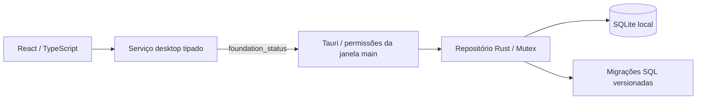

# Arquitetura

Referência de escopo: [Projeto mestre](PROJETO_MESTRE.md).

## Componentes e fronteiras



`src/app` define navegação por hash e composição. `layouts` contém a moldura da janela. `pages` contém Dashboard, Configurações e a página de funcionalidades futuras. `components` reúne elementos reutilizáveis e a barreira de erro. `hooks` coordena carregamento e descarte de respostas obsoletas. `services` é a fronteira IPC. `types` define os DTOs; `styles` define tokens globais e o layout usa CSS Modules.

Não há roteador externo: oito páginas estáticas são atendidas por links de hash, com suporte a histórico e atualização direta. Rotas desconhecidas exibem Dashboard. Ao navegar, o conteúdo principal recebe foco e o título do documento muda. Isso não impede adotar roteador na fase que exigir parâmetros, rotas aninhadas ou formulários complexos.

`src-tauri/src/lib.rs` resolve caminhos pelo Tauri, cria o diretório de dados e guarda `Result<Repository, AppError>` no estado. Uma falha do banco mantém a janela utilizável para mostrar orientação. O repositório não depende do Tauri; recebe um caminho confiável do chamador. `database.rs` controla conexão e migrações. Nenhum comando aceita SQL ou caminho vindo do frontend.

## Contrato IPC da Fase 01

Comando `foundation_status`, sem argumentos, retorna:

```ts
interface FoundationStatus {
  schemaVersion: number;
  databasePath: string;
  integrity: 'ok';
  settings: { timezone: string; createdAt: string; updatedAt: string };
}
```

Falhas: `{ code, message }` com códigos `DATABASE_UNAVAILABLE`, `DATABASE_INTEGRITY` ou `SCHEMA_UNSUPPORTED`. A UI mapeia códigos conhecidos para mensagens próprias e oculta detalhes de falhas desconhecidas. `integrity: 'ok'` só existe em retorno bem-sucedido. Mock de IPC aparece apenas nos testes.

`foundation_status` consulta o banco aberto. “Verificar novamente” repete leitura e integridade; se a abertura inicial falhou, é necessário corrigir a causa e reiniciar a janela para tentar abrir novamente. Não há reset de banco ou recuperação automática.

## Persistência

- Caminho calculado por `app.path().app_data_dir()`; no Windows, normalmente `%APPDATA%\br.com.gmad.socialplanner\planner.sqlite3`. O diagnóstico mostra o caminho realmente resolvido, sem pressupor perfil fixo.
- Acesso SQLite via rusqlite com SQLite incorporado (`bundled`); não exige instalar um servidor ou SQLite separadamente.
- Uma conexão protegida por `Mutex`, timeout de bloqueio de 5 segundos e foreign keys habilitadas.
- Fase 01 mantém o journal padrão de SQLite. WAL não é necessário para a carga mínima. Se adotado futuramente, revisar backup e operação concorrente.
- `PRAGMA quick_check` antes/depois da migração e em cada diagnóstico. É verificação básica, não substitui testes completos de recuperação e foreign keys nas fases editoriais.
- Todas as migrações pendentes e seus registros são aplicados na mesma transação `IMMEDIATE`; erro reverte o lote. SQL original aplicado é armazenado para detectar alteração indevida do histórico.
- Banco com versão futura, histórico divergente ou tabelas preexistentes sem histórico conhecido é rejeitado, sem exclusão.

## Segurança

`build.rs` declara o comando de aplicação no manifesto; a capability `main` concede apenas `allow-foundation-status` à janela `main`. Não há permissões para origens remotas, plugins de SQL, filesystem, shell ou HTTP. A CSP de produção permite ativos locais e IPC; a política de desenvolvimento adiciona somente o necessário para Vite/HMR em loopback. Recursos externos não são carregados pela UI.

Credenciais e integração serão responsabilidade do Rust nas fases próprias. O SQLite editorial não é um cofre de segredos; arquivos locais herdam proteção do perfil Windows e não são criptografados por este aplicativo nesta fase. Guardar tokens no armazenamento seguro do sistema operacional quando existir autorização externa.

## Desenvolvimento e operação

`npm run dev` verifica Cargo, inicia Vite com porta `0` (livre, escolhida pelo sistema), obtém a URL real e inicia a CLI Tauri com override de `build.devUrl`. O servidor é fechado ao sair da CLI. Não há porta fixa obrigatória ou regra de firewall necessária. O servidor só escuta em `127.0.0.1`.

`npm run dev:web` é uma prévia da UI: não cria nem acessa banco. O aviso explícito evita confundir navegação web com integração desktop validada. Em produção os ativos do Vite são incorporados ao executável Tauri; nenhum servidor web remoto é exigido.

Build nativo e testes Rust exigem Rust MSVC, ferramentas C++ e Windows SDK; WebView2 é necessário para abrir a janela. A distribuição/instalador pertence à Fase 09; `build:desktop` prepara o executável sem bundle.

## Logs e backup

A fundação registra somente `DATABASE_READY` ou código de falha em stderr durante desenvolvimento. Não há arquivo de log persistente ou rotação nesta fase; edição release sem console não apresenta esses registros ao usuário. Erros do banco aparecem na UI. Diagnóstico persistente e suporte a backup devem ser evoluídos explicitamente.

Backup futuro: snapshot consistente usando API de backup SQLite, manifesto de versão e mídias locais referenciadas; validar integridade e testes de restauração. Nunca copiar apenas o `.sqlite3` aberto em WAL. Antes de restaurar, preservar os dados anteriores e validar compatibilidade. Nenhum backup automático foi implementado.

## Estrutura deliberadamente enxuta

`features/` e `utils/` serão criados quando houver domínio ou utilidades reais. Não existem pastas vazias para sugerir funcionalidades prontas. O símbolo em `public/brand.svg` e os ícones Tauri são provisórios, não representam identidade GMAD aprovada. Instalação e critérios de validação estão no README e no relatório da fase.
