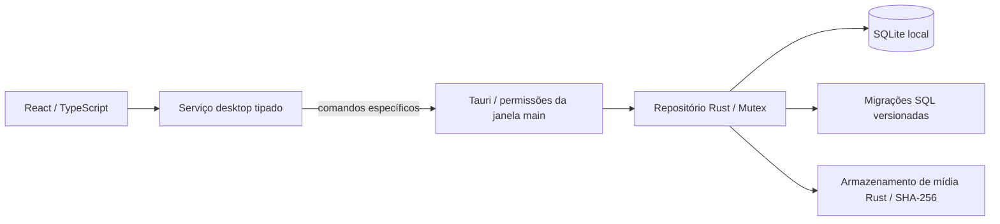

# Arquitetura

Referência de escopo: [Projeto mestre](PROJETO_MESTRE.md).

## Componentes e fronteiras



`src/app` define navegação por hash e composição. `layouts` contém AppShell (reaproveitado em AppLayout.tsx), Sidebar e Topbar. `pages` contém oito layouts distintos: Dashboard, Biblioteca, Importações, Revisão, Calendário, Nova publicação, Histórico e Configurações. `components/ui` reúne primitivas próprias, sem biblioteca completa de UI; `components` mantém diagnóstico, cabeçalho e barreira de erro. `hooks` coordena carregamento e descarte de respostas obsoletas. `services` é a fronteira IPC. `types` define os DTOs; `styles` define tokens, primitivas e composições; o shell usa CSS Modules. `utils/calendar.ts` calcula somente a grade visual e o dia no fuso IANA, sem persistência/agendamento.

Não há roteador externo: páginas são atendidas por links de hash, com histórico e atualização direta. A Fase 03 acrescenta `#/biblioteca/<uuid>` e `#/biblioteca/<uuid>/editar`, com formulários e guarda de alterações não salvas em navegação, histórico e fechamento da janela. Rotas desconhecidas exibem Dashboard. Ao navegar, o conteúdo principal recebe foco e o título do documento muda.

`src-tauri/src/lib.rs` resolve caminhos pelo Tauri, cria o diretório de dados e guarda `Mutex<Result<EditorialRepository, AppError>>` no estado. Falha de abertura mantém a janela utilizável para mostrar orientação. O repositório não depende do Tauri; recebe caminho confiável do chamador. `database.rs` controla conexão/migrações; `editorial_domain.rs` valida DTOs e regras; `editorial_repository.rs` controla consultas/transações/versionamento; `media_store.rs` valida/copia arquivos e calcula checksums. Operações editoriais usam `spawn_blocking`. Nenhum comando aceita SQL ou caminho de origem vindo do frontend.

## Contrato IPC da Fase 01

Comando `foundation_status`, sem argumentos, retorna:

```ts
interface FoundationStatus {
  schemaVersion: number;
  databasePath: string;
  integrity: 'ok';
  settings: { timezone: string; createdAt: string; updatedAt: string };
}
```

Falhas: `{ code, message }` com códigos `DATABASE_UNAVAILABLE`, `DATABASE_INTEGRITY` ou `SCHEMA_UNSUPPORTED`. A UI mapeia códigos conhecidos para mensagens próprias e oculta detalhes de falhas desconhecidas. `integrity: 'ok'` só existe em retorno bem-sucedido. Mock de IPC aparece apenas nos testes.

`foundation_status` consulta o banco aberto. “Verificar novamente” repete leitura e integridade; se a abertura inicial falhou, é necessário corrigir a causa e reiniciar a janela para tentar abrir novamente. Não há reset de banco ou recuperação automática.

## Persistência

- Caminho calculado por `app.path().app_data_dir()`; no Windows, normalmente `%APPDATA%\br.com.gmad.socialplanner\planner.sqlite3`. O diagnóstico mostra o caminho realmente resolvido, sem pressupor perfil fixo.
- Acesso SQLite via rusqlite com SQLite incorporado (`bundled`); não exige instalar um servidor ou SQLite separadamente.
- Uma conexão protegida por `Mutex`, timeout de bloqueio de 5 segundos e foreign keys habilitadas.
- Fase 01 mantém o journal padrão de SQLite. WAL não é necessário para a carga mínima. Se adotado futuramente, revisar backup e operação concorrente.
- `PRAGMA quick_check` antes/depois da migração e em cada diagnóstico. É verificação básica, não substitui testes completos de recuperação e foreign keys nas fases editoriais.
- Todas as migrações pendentes e seus registros são aplicados na mesma transação `IMMEDIATE`; erro reverte o lote. SQL original aplicado é armazenado para detectar alteração indevida do histórico.
- Banco com versão futura, histórico divergente ou tabelas preexistentes sem histórico conhecido é rejeitado, sem exclusão.

## Segurança

`build.rs` declara os comandos de aplicação no manifesto; a capability `main` concede diagnóstico e oito comandos editoriais específicos, além de listen/unlisten de eventos e destroy para guarda de fechamento. Não há permissões genéricas para origens remotas, SQL, filesystem, shell ou HTTP. O seletor oficial dialog é chamado apenas pelo Rust. Protocolo asset inicia com escopo vazio e libera somente mídia/staging controlados; CSP permite esses ativos locais em img-src/media-src. Desenvolvimento adiciona Vite/HMR em loopback. Recursos externos não são carregados pela UI.

Credenciais e integração serão responsabilidade do Rust nas fases próprias. O SQLite editorial não é um cofre de segredos; arquivos locais herdam proteção do perfil Windows e não são criptografados por este aplicativo nesta fase. Guardar tokens no armazenamento seguro do sistema operacional quando existir autorização externa.

## Desenvolvimento e operação

`npm run dev` verifica Cargo, inicia Vite com porta `0` (livre, escolhida pelo sistema), obtém a URL real e inicia a CLI Tauri com override de `build.devUrl`. O servidor é fechado ao sair da CLI. Não há porta fixa obrigatória ou regra de firewall necessária. O servidor só escuta em `127.0.0.1`.

Para QA, `npm.cmd run dev -- --window-size 1366x768` aplica dimensões transitórias de conteúdo à janela principal, preservando os demais atributos da configuração. Aceita 640×520 a 2560×1440. Não modifica tauri.conf.json, identificador, CSP ou contratos IPC.

`npm run dev:web` é uma prévia da UI: não cria nem acessa banco. O aviso explícito evita confundir navegação web com integração desktop validada. Em produção os ativos do Vite são incorporados ao executável Tauri; nenhum servidor web remoto é exigido.

Build nativo e testes Rust exigem Rust MSVC, ferramentas C++ e Windows SDK; WebView2 é necessário para abrir a janela. A distribuição/instalador pertence à Fase 09; `build:desktop` prepara o executável sem bundle.

## Logs e backup

A fundação registra somente `DATABASE_READY` ou código de falha em stderr durante desenvolvimento. Não há arquivo de log persistente ou rotação nesta fase; edição release sem console não apresenta esses registros ao usuário. Erros do banco aparecem na UI. Diagnóstico persistente e suporte a backup devem ser evoluídos explicitamente.

Backup futuro: snapshot consistente usando API de backup SQLite, manifesto de versão e mídias locais referenciadas; validar integridade e testes de restauração. Nunca copiar apenas o `.sqlite3` aberto em WAL. Antes de restaurar, preservar os dados anteriores e validar compatibilidade. Nenhum backup automático foi implementado.

## Estrutura deliberadamente enxuta

`features/editorial/` reúne formulário e prévias de mídia; páginas/hook/serviço/tipos editoriais preservam fronteiras de apresentação e IPC. `utils/` contém a utilidade visual do calendário. Não existem pastas vazias para sugerir funcionalidades prontas. Símbolo e ícones seguem a identidade proposta na Fase 02, sem representar códigos oficiais de marca. Inter licenciada é local. Diretrizes em DESIGN_SYSTEM.md; instalação e critérios de validação no README e nos relatórios.

## Persistência editorial da Fase 03

Migração 002 cria publications, media_assets e publication_media. Save é transacional e verifica versão esperada; duplicação compartilha assets; exclusão é lógica e conserva vínculos/arquivos. Busca normalizada, filtros e ordenações usam valores validados e consultas limitadas; cards recebem só a mídia principal. Dashboard consulta registros ativos reais.

Mídias em `media/<sha256>.<extensão>`, staging em `temp/imports/<sessão>`, sob a raiz Tauri. Importação copia em blocos, valida conteúdo e limites, sem transformar bytes ou carregar vídeos inteiros. Promoção usa hard link atômico ou fallback de cópia sincronizada/rename. Falha anterior ao commit reverte banco e somente arquivos novos; resultado incerto conserva arquivos. Não existe limpeza destrutiva automática. Detalhes, limites e contratos em [Fase 03](FASE_03_BIBLIOTECA_EDITORIAL.md).

`GMAD_QA_DATA_DIR`, absoluto e opt-in, permite perfil isolado exclusivamente em debug. Release ignora a variável e mantém o diretório operacional do Tauri. Testes Rust usam bancos/arquivos temporários; testes de componentes simulam somente sua fronteira IPC.
