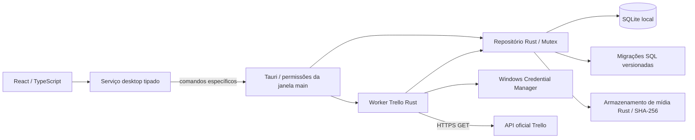

# Arquitetura

Referência de escopo: [Projeto mestre](PROJETO_MESTRE.md).

## Componentes e fronteiras



`src/app` define navegação por hash e composição. `layouts` contém AppShell (reaproveitado em AppLayout.tsx), Sidebar e Topbar. `pages` contém oito layouts distintos: Dashboard, Biblioteca, Importações, Revisão, Calendário, Nova publicação, Histórico e Configurações. `components/ui` reúne primitivas próprias, sem biblioteca completa de UI; `components` mantém diagnóstico, cabeçalho e barreira de erro. `hooks` coordena carregamento e descarte de respostas obsoletas. `services` é a fronteira IPC. `types` define os DTOs; `styles` define tokens, primitivas e composições; o shell usa CSS Modules. `utils/calendar.ts` calcula somente a grade visual e o dia no fuso IANA, sem persistência/agendamento.

Não há roteador externo: páginas são atendidas por links de hash, com histórico e atualização direta. A Fase 03 acrescenta `#/biblioteca/<uuid>` e `#/biblioteca/<uuid>/editar`, com formulários e guarda de alterações não salvas em navegação, histórico e fechamento da janela. Rotas desconhecidas exibem Dashboard. Ao navegar, o conteúdo principal recebe foco e o título do documento muda.

`src-tauri/src/lib.rs` resolve caminhos pelo Tauri, cria o diretório de dados e guarda `Mutex<Result<EditorialRepository, AppError>>` no estado. Falha de abertura mantém a janela utilizável para mostrar orientação. O repositório não depende do Tauri; recebe caminho confiável do chamador. `database.rs` controla conexão/migrações; `editorial_domain.rs` valida DTOs e regras; `editorial_repository.rs` controla consultas/transações/versionamento; `media_store.rs` valida/copia arquivos e calcula checksums. Operações editoriais usam `spawn_blocking`. Nenhum comando aceita SQL ou caminho de origem vindo do frontend.

## Contrato IPC da Fase 01

Comando `foundation_status`, sem argumentos, retorna:

```ts
interface FoundationStatus {
  schemaVersion: number;
  databasePath: string;
  integrity: 'ok';
  settings: { timezone: string; createdAt: string; updatedAt: string };
}
```

Falhas: `{ code, message }` com códigos `DATABASE_UNAVAILABLE`, `DATABASE_INTEGRITY` ou `SCHEMA_UNSUPPORTED`. A UI mapeia códigos conhecidos para mensagens próprias e oculta detalhes de falhas desconhecidas. `integrity: 'ok'` só existe em retorno bem-sucedido. Mock de IPC aparece apenas nos testes.

`foundation_status` consulta o banco aberto. “Verificar novamente” repete leitura e integridade; se a abertura inicial falhou, é necessário corrigir a causa e reiniciar a janela para tentar abrir novamente. Não há reset de banco ou recuperação automática.

## Persistência

- Caminho calculado por `app.path().app_data_dir()`; no Windows, normalmente `%APPDATA%\br.com.gmad.socialplanner\planner.sqlite3`. O diagnóstico mostra o caminho realmente resolvido, sem pressupor perfil fixo.
- Acesso SQLite via rusqlite com SQLite incorporado (`bundled`); não exige instalar um servidor ou SQLite separadamente.
- Uma conexão protegida por `Mutex`, timeout de bloqueio de 5 segundos e foreign keys habilitadas.
- Fase 01 mantém o journal padrão de SQLite. WAL não é necessário para a carga mínima. Se adotado futuramente, revisar backup e operação concorrente.
- `PRAGMA quick_check` antes/depois da migração e em cada diagnóstico. É verificação básica, não substitui testes completos de recuperação e foreign keys nas fases editoriais.
- Todas as migrações pendentes e seus registros são aplicados na mesma transação `IMMEDIATE`; erro reverte o lote. SQL original aplicado é armazenado para detectar alteração indevida do histórico.
- Banco com versão futura, histórico divergente ou tabelas preexistentes sem histórico conhecido é rejeitado, sem exclusão.

## Segurança

`build.rs` declara os comandos de aplicação no manifesto; a capability `main` concede diagnóstico, oito comandos editoriais e dez comandos Trello específicos e quatro comandos de revisão editorial, além de listen/unlisten de eventos e destroy para guarda de fechamento. Não há permissões genéricas para origens remotas, SQL, filesystem, shell ou HTTP. O seletor oficial dialog é chamado apenas pelo Rust. Protocolo asset inicia com escopo vazio e libera somente mídia/staging controlados; CSP permite esses ativos locais em img-src/media-src. Desenvolvimento adiciona Vite/HMR em loopback. Recursos externos não são carregados pela UI.

Credenciais e integração Trello são responsabilidade do Rust. O SQLite editorial não é um cofre de segredos; arquivos locais herdam proteção do perfil Windows e não são criptografados por este aplicativo nesta fase. O token Trello fica exclusivamente no Windows Credential Manager; o frontend só recebe a entrada transitória do formulário e a limpa ao enviar.

## Desenvolvimento e operação

`npm run dev` verifica Cargo, inicia Vite com porta `0` (livre, escolhida pelo sistema), obtém a URL real e inicia a CLI Tauri com override de `build.devUrl`. O servidor é fechado ao sair da CLI. Não há porta fixa obrigatória ou regra de firewall necessária. O servidor só escuta em `127.0.0.1`.

Para QA, `npm.cmd run dev -- --window-size 1366x768` aplica dimensões transitórias de conteúdo à janela principal, preservando os demais atributos da configuração. Aceita 640×520 a 2560×1440. Não modifica tauri.conf.json, identificador, CSP ou contratos IPC.

`npm run dev:web` é uma prévia da UI: não cria nem acessa banco. O aviso explícito evita confundir navegação web com integração desktop validada. Em produção os ativos do Vite são incorporados ao executável Tauri; nenhum servidor web remoto é exigido.

Build nativo e testes Rust exigem Rust MSVC, ferramentas C++ e Windows SDK; WebView2 é necessário para abrir a janela. A distribuição/instalador pertence à Fase 09; `build:desktop` prepara o executável sem bundle.

## Logs e backup

A fundação registra somente `DATABASE_READY` ou código de falha em stderr durante desenvolvimento. Não há arquivo de log persistente ou rotação nesta fase; edição release sem console não apresenta esses registros ao usuário. Erros do banco aparecem na UI. Diagnóstico persistente e suporte a backup devem ser evoluídos explicitamente.

Backup futuro: snapshot consistente usando API de backup SQLite, manifesto de versão e mídias locais referenciadas; validar integridade e testes de restauração. Nunca copiar apenas o `.sqlite3` aberto em WAL. Antes de restaurar, preservar os dados anteriores e validar compatibilidade. Nenhum backup automático foi implementado.

## Estrutura deliberadamente enxuta

`features/editorial/` reúne formulário e prévias de mídia; páginas/hook/serviço/tipos editoriais preservam fronteiras de apresentação e IPC. `utils/` contém a utilidade visual do calendário. Não existem pastas vazias para sugerir funcionalidades prontas. Símbolo e ícones seguem a identidade proposta na Fase 02, sem representar códigos oficiais de marca. Inter licenciada é local. Diretrizes em DESIGN_SYSTEM.md; instalação e critérios de validação no README e nos relatórios.

## Persistência editorial da Fase 03

Migração 002 cria publications, media_assets e publication_media. Save é transacional e verifica versão esperada; duplicação compartilha assets; exclusão é lógica e conserva vínculos/arquivos. Busca normalizada, filtros e ordenações usam valores validados e consultas limitadas; cards recebem só a mídia principal. Dashboard consulta registros ativos reais.

Mídias em `media/<sha256>.<extensão>`, staging em `temp/imports/<sessão>`, sob a raiz Tauri. Importação copia em blocos, valida conteúdo e limites, sem transformar bytes ou carregar vídeos inteiros. Promoção usa hard link atômico ou fallback de cópia sincronizada/rename. Falha anterior ao commit reverte banco e somente arquivos novos; resultado incerto conserva arquivos. Não existe limpeza destrutiva automática. Detalhes, limites e contratos em [Fase 03](FASE_03_BIBLIOTECA_EDITORIAL.md).

`GMAD_QA_DATA_DIR`, absoluto e opt-in, permite perfil isolado exclusivamente em debug. Release ignora a variável e mantém o diretório operacional do Tauri. Testes Rust usam bancos/arquivos temporários; testes de componentes simulam somente sua fronteira IPC.

## Integração Trello da Fase 04

Os módulos trello_domain, trello_api, trello_redirect, trello_vault, trello_service e trello_repository separam DTOs/validação, transporte oficial, política de redirecionamento, credenciais, coordenação e SQLite. reqwest blocking com rustls atende endpoints construídos para api.trello.com por HTTPS. Somente downloads de anexos podem seguir até três redirecionamentos para o host exato files.trello.com por HTTPS/443, usando cliente separado sem credenciais, validação de destino em cada salto e DNS público fixado na conexão. Não há cliente HTTP no frontend. URLs de referência não são destinos de download. O transporte é substituível exclusivamente nos testes offline. Regras completas em [Integração Trello](INTEGRACAO_TRELLO.md).

TrelloState serializa operações, mantém a prévia em memória por 15 minutos, cancelamento atômico e progresso consultável. Comandos usam spawn_blocking. Rede, download e inspeção de arquivos ocorrem fora do mutex editorial; o checksum é reconferido dentro da transação por cartão antes de criar vínculos, protegendo contra arquivos modificados/revertidos por outra operação. Essa leitura de disco pode bloquear brevemente consultas locais, especialmente com vídeos grandes.

A migração 003 é aditiva e mantém 001/002 intactas. Snapshot remoto e Publication são independentes; reimportação nunca sobrescreve composição/estado/versão editorial. Arquivos completos promovidos são conservados em falhas posteriores; temporários conhecidos são removidos. Jobs interrompidos são identificados ao abrir o aplicativo. Não existe limpeza destrutiva de arquivos órfãos.

Configurações → Trello usa autorização pessoal oficial somente leitura e cofre nativo; Importações oferece prévia, confirmação, limites, progresso, cancelamento e histórico. Detalhes/editor mostram origem e anexos; anexos novos entram na composição somente por ação explícita. O cadastro manual permanece independente. Aprovação/revisão foram implementadas na Fase 05; calendário persistente na Fase 06.

Contratos, fontes oficiais e limitações: [Integração Trello](INTEGRACAO_TRELLO.md). Evidências e distinção entre mocks e serviço real: [Fase 04](FASE_04_INTEGRACAO_TRELLO.md).

## Revisão editorial da Fase 05

`review.rs` amplia o repositório existente com fila, análise, decisões e histórico; quatro comandos específicos (`review_list`, `review_get`, `review_decide`, `review_history`) usam o worker bloqueante e o mutex editorial existente. SQL parametrizado e DTOs restritos mantêm o frontend sem acesso genérico ao banco/arquivos. Migração 004 adiciona eventos imutáveis; atualização otimista e auditoria são atômicas por publicação. Lotes retornam um resultado por alvo, sem transação global que descarte os sucessos.

Review, ReviewIndividual e ReviewHistory compõem os controles existentes; PublicationEditor e MediaPreview são reutilizados. Guarda de navegação/fechamento compartilha salvar/descartar/permanecer, sem salvar implicitamente. Filas mantêm IDs ordenados da seleção aberta, filtros/página e navegação segura fora de campos. Inspeção completa verifica hashes e conteúdo no worker Rust; a listagem usa caminho/tamanho. Vídeos usam controles WebView2, com falha de reprodução distinta de download. Limites e evidências em [Fase 05](FASE_05_REVISAO_EDITORIAL.md).

## Calendário editorial da Fase 06

`calendar.rs` amplia o mesmo repositório com os comandos específicos `calendar_list`, `calendar_available`, `schedule_save`, `schedule_cancel`, `schedule_settings_save`, `planning_dashboard` e `schedule_history`. DTOs restritos, worker bloqueante, mutex existente e SQL parametrizado. React organiza calendário/fila/formulários; serviços/tipos separam IPC; PlanningSummary e PlanningHistory reutilizam apresentação editorial e MediaPreview. Nenhum acesso genérico novo ao disco/banco e nenhuma integração Meta.

Migração 005 cria schedules, schedule_settings e schedule_events imutáveis. Gravações usam transação imediata, versão esperada, índice único parcial e triggers de aprovação/auditoria. Mudança editorial invalida planos ativos na mesma transação, incluindo comandos existentes de edição, revisão e exclusão lógica. Reimportação de snapshot preserva planos. Cancelar mantém registros e mídia compartilhada.

Data/hora/fuso IANA explícitos são convertidos por Chrono/chrono-tz no Rust, rejeitando ambiguidades e lacunas DST; persistem também UTC. Conflitos são calculados no backend sobre instantes, inclusive fora dos filtros, com proximidade configurável. Listagem mensal é limitada a 10.000 registros; fila/histórico paginados. Validação completa reutiliza review_item; consultas usam inspeção leve e avisos. Sem scheduler, tarefas remotas ou estados de confirmação externa.

Arraste interno usa Pointer Events com captura e validação de IDs/destino, com alternativa HTML5; sempre abre confirmação, sem gravar no drop. `dragDropEnabled: false` na janela evita interceptação de arquivos pelo Tauri e permite HTML5 no Windows; não habilita importação arbitrária de arquivos. A alternativa por botões e formulário continua integral. Evidências nativas, dependências e limites em [Fase 06](FASE_06_CALENDARIO_EDITORIAL.md).

## Fase 07 — arquitetura Meta apenas documental

A pesquisa em [Viabilidade Meta](FASE_07_VIABILIDADE_META.md) não implementa componente, comando, dependência ou migração. O desenho recomendado da Fase 08 é preparação local versionada e agendamento manual no Business Suite; acompanhamento assistido deve distinguir declaração do operador de confirmação da API. Sem automação do navegador, segredo de app no desktop ou backend remoto obrigatório.

Uma alternativa futura de API imediata exige token no cofre Rust, transporte de imagem aprovado, validação de formato e tentativas/auditoria externas separadas do Schedule local. Trocas OAuth com App Secret exigem servidor; token administrativo do painel é alternativa para conta própria, sem resolver transporte/agendamento. Nenhum agendamento remoto Instagram foi comprovado pelo contrato público pesquisado. Rede futura deve ficar fora do mutex editorial, com transações curtas e reconciliação antes de repetir envios. Contratos propostos, sem implementação, em [Integração Meta](INTEGRACAO_META.md).

## Fase 08 — preparação e declaração manual

`assisted.rs` amplia o repositório com elegibilidade, snapshots/assinatura, preparação individual/lote, declaração/revisão otimista, reconciliação explícita e consultas de acompanhamento. `assisted_files.rs` concentra raízes autorizadas, cópia em blocos, hashes, manifesto, staging/promoção e abertura Windows. Sem novas dependências. React reutiliza componentes, guarda de saída e MediaPreview; tipos/serviço IPC próprios, rota `#/assistido`, resumo real no Dashboard e aba própria no Histórico.

Nove comandos específicos: `assisted_list`, `assisted_prepare`, `assisted_confirm`, `assisted_reconcile`, `assisted_history`, `assisted_caption`, `assisted_folder_open`, `assisted_business_open`, `assisted_choose_root`. Permissões Tauri restritas à janela existente, sem alterar CSP nem expor SQL, shell, filesystem ou URL arbitrários. Seletor nativo é aguardado fora do mutex editorial; somente a escolha validada é persistida. Abertura usa ShellExecuteW na thread principal, para pasta de preparação atual ou URL fixa do Business Suite. O navegador fica sob controle humano.

Migração 006 aditiva: raízes/preferência, preparações e declarações versionadas, eventos imutáveis. Triggers invalidam pacotes e declarações após alteração editorial/planejamento, preservando contratos antigos. Assinatura inclui versão, conteúdo/ordem de mídia e calendário. Consulta/abertura/cópia/confirmação verificam integridade completa do pacote; copiar/abrir não confirma agendamento. Declaração exige checkbox e instante efetivo explícitos; divergência mantém calendário intacto até reconciliação solicitada. Revisão substitui a declaração antiga, que é retida.

Staging e destino final compartilham pasta/volume; arquivos sincronizados são promovidos por rename sem sobrescrever pacote anterior. Pré-checagem Windows de espaço livre e erros de escrita têm tratamento local. Não existe transação distribuída SQLite/filesystem: registro `preparing` antecede cópia, sucesso é persistido depois; recuperação no startup limpa somente staging conhecido seguro e registra falha, conservando eventual pasta final. Não há limpeza automática de pacotes concluídos. Raízes antigas continuam registradas após trocar a preferência.

Operações de disco/hashes usam worker bloqueante sob o mutex existente; meses/vídeos grandes podem atrasar outras consultas locais. Use uma instância por perfil. Produto não promete segurança contra troca maliciosa concorrente de diretório pelo mesmo usuário, nem atomicidade contra perda de energia em todas as etapas. Limites, testes e evidências em [Fase 08](FASE_08_AGENDAMENTO_ASSISTIDO.md); [guia operacional](GUIA_AGENDAMENTO_META.md). Nenhuma chamada Meta implementada; API futura descrita na Fase 07 permanece proposta.
