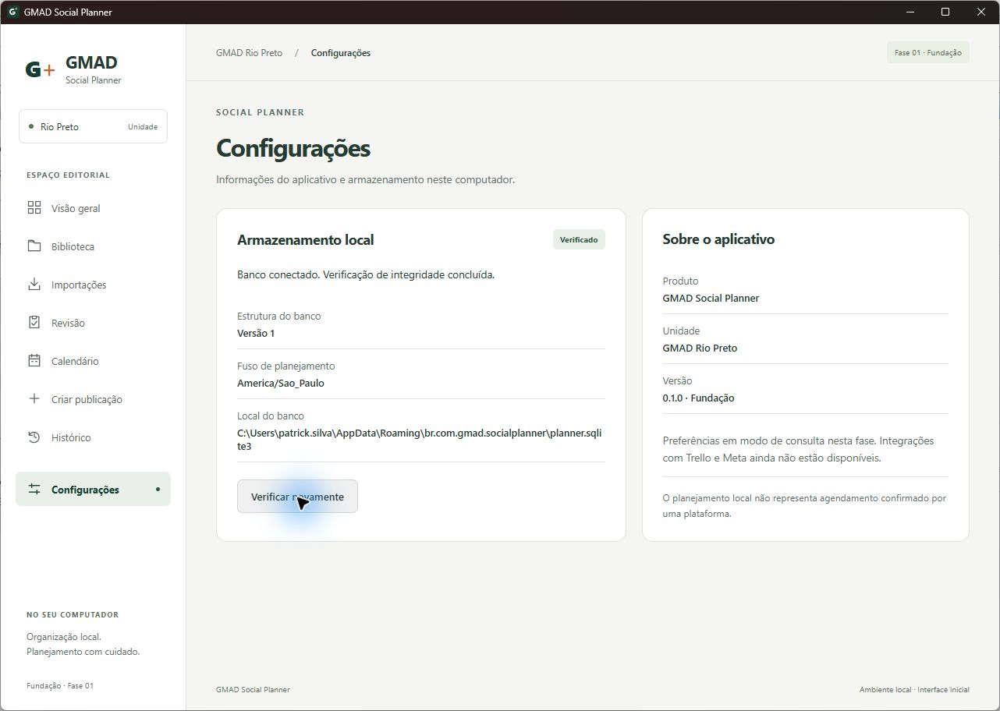

# Fase 01.5 — Preparação e validação Windows

Data: 13/10/2026 (America/Sao_Paulo). Base: `6c13397` — `feat: initialize GMAD Social Planner foundation`.

**Estado atual: ambiente instalado e validação técnica da Fase 01 concluída.** Janela nativa, navegação, IPC, SQLite e persistência após reabertura foram comprovados. A Fase 02 está liberada tecnicamente para solicitação do usuário, mas não foi iniciada.

## Diagnóstico inicial

AGENTS.md, README.md e PROJETO_MESTRE.md foram lidos antes das alterações. `git status --short` estava vazio; o repositório estava no commit de fundação.

| Componente | Resultado observado |
| --- | --- |
| Windows | Microsoft Windows 11 Pro, 64 bits, versão 10.0.26300 confirmada por CIM; registro: build 26300.9550, DisplayVersion 26H2. O campo legado ProductName informa Windows 10 Pro e não foi usado para inferir a edição atual |
| Node.js | 24.11.1, `C:\Program Files\nodejs\node.exe` |
| npm | 11.6.2, `C:\Program Files\nodejs\npm.cmd` |
| rustc | Ausente no PATH; diretório padrão de toolchains inexistente |
| Cargo | Ausente no PATH; `%USERPROFILE%\.cargo\bin` inexistente |
| rustup | Ausente no PATH; `%USERPROFILE%\.rustup\toolchains` inexistente |
| Microsoft C++ Build Tools | Não encontrado nos diretórios padrão nem entre programas registrados; vswhere ausente |
| MSVC x64/x86 | Não disponível; `cl` não encontrado e nenhuma instalação Visual Studio/Build Tools localizada |
| Windows SDK | Não encontrado em Windows Kits/10/Include nem em Installed Roots do registro |
| WebView2 | Versão 155.0.4283.45 já presente; também existe diretório 154.0.4258.62. Não requer reinstalação |

O PATH de usuário e máquina foi lido sem alteração: Node está disponível; `.cargo\bin` não está configurado. Não foram encontradas variáveis CARGO_HOME, RUSTUP_HOME, VSCMD, VCINSTALLDIR ou WindowsSdkDir que apontassem para uma instalação alternativa. Ausência de `cl` em terminal comum, isoladamente, não prova ausência de MSVC; a conclusão usa também diretórios e registro.

Somente Rust/rustup/Cargo, Build Tools/MSVC e Windows SDK precisam de instalação. Não é necessário reinstalar Node, npm ou WebView2, instalar Visual Studio IDE completo, SQLite independente ou habilitar componentes de criação de MSI para este build sem bundle.

## Preparação da instalação

Instaladores baixados de fontes oficiais para `.tmp/windows-setup/`, diretório ignorado pelo Git. **Baixar não significa instalar. Nenhum instalador foi executado nesta etapa.**

| Arquivo | Origem | Verificação local |
| --- | --- | --- |
| rustup-init.exe | https://win.rustup.rs/x86_64, disponibilizado em rustup.rs | 12.721.664 bytes; SHA-256 `6F4BEF66261261FCB43131BE8720BAB817D403A09EDEC7455C371974B90BDB7E` |
| vs_BuildTools.exe | https://aka.ms/vs/17/release/vs_BuildTools.exe | 4.478.032 bytes; versão do bootstrapper 17.14.37710.0; Authenticode **Valid**, Microsoft Corporation; SHA-256 `985969F472CAAD75D993A5CB4C35A6A4271460CC12B343E2433B994D173AA990` |

Os hashes acima identificam os downloads desta execução; não são uma comparação com checksum publicado separadamente. A versão do bootstrapper não representa uma toolchain instalada.

Escopo proposto: Build Tools 2022, workload `Microsoft.VisualStudio.Workload.VCTools`, compilador `Microsoft.VisualStudio.Component.VC.Tools.x86.x64` e SDK `Microsoft.VisualStudio.Component.Windows11SDK.26100`, com suas dependências obrigatórias. Rust estável via rustup, host `x86_64-pc-windows-msvc`, perfil mínimo mais rustfmt e Clippy. Rust no perfil do usuário; `.cargo\bin` no PATH de usuário. Não reiniciar automaticamente.

A instalação administrativa e a alteração persistente de PATH foram executadas após a resposta explícita do usuário: **“Autorizo essas instalações e a alteração do PATH”**. Os downloads acima foram preparados antes dessa autorização.

## Instalação autorizada e versões finais

O bootstrapper Microsoft foi executado com `--add Microsoft.VisualStudio.Workload.VCTools --add Microsoft.VisualStudio.Component.VC.Tools.x86.x64 --add Microsoft.VisualStudio.Component.Windows11SDK.26100 --passive --wait --norestart`. O processo retornou **0**. `vswhere` confirmou `isComplete: true`, `isLaunchable: true` e `isRebootRequired: false`. Não foi instalada a IDE completa.

Rustup foi executado com `-y --default-host x86_64-pc-windows-msvc --default-toolchain stable --profile minimal --component rustfmt --component clippy`, retornando **0**. O instalador adicionou `C:\Users\patrick.silva\.cargo\bin` ao PATH do usuário. Os comandos deste processo também receberam esse caminho no PATH transitório, pois o aplicativo já estava aberto antes da instalação.

| Componente | Versão instalada / confirmação |
| --- | --- |
| Rust | `rustc 1.99.0 (b940084d7 2026-09-28)` |
| Cargo | `cargo 1.99.0 (5f94df478 2026-08-27)` |
| rustup | `1.29.1 (d95a37b6a 2026-08-13)` |
| Toolchain / target | `stable-x86_64-pc-windows-msvc`, padrão; target `x86_64-pc-windows-msvc` instalado |
| Componentes Rust | cargo, rustc, rust-std, rustfmt e Clippy instalados |
| Build Tools 2022 | 17.14.41, installationVersion 17.14.37710.0 |
| MSVC | Diretório de ferramentas 14.44.35207; `cl.exe` informa compilador 19.44.35229 x64 |
| Windows SDK | Headers e bibliotecas em 10.0.26100.0; `kernel32.lib` x64 confirmado |
| Node / npm / WebView2 | Mantidos em 24.11.1 / 11.6.2 / 155.0.4283.45 |

Não houve reinicialização do computador. Não foi necessária instalação manual adicional. Rustup emitiu aviso transitório de pré-requisitos MSVC porque os Build Tools ainda estavam sendo instalados; a instalação Microsoft terminou antes da compilação, e `cargo check`/builds comprovaram a disponibilidade das ferramentas.

## Instalação manual, caso escolhida

1. Na pasta do projeto, abra `.tmp\windows-setup\vs_BuildTools.exe`. Autorize o UAC conscientemente. Selecione **Desktop development with C++ / Desenvolvimento para desktop com C++**.
2. Confirme os componentes **MSVC v143 — VS 2022 C++ x64/x86 build tools** e **Windows 11 SDK 10.0.26100**. Instale apenas Build Tools e dependências desse escopo. Não é necessário instalar a IDE Visual Studio ou cargas de trabalho web/mobile.
3. Aguarde o término. Se o instalador exigir reinicialização, salve seu trabalho e decida quando reiniciar; esta tarefa não reiniciará o computador automaticamente.
4. Execute `.tmp\windows-setup\rustup-init.exe`. Use host `x86_64-pc-windows-msvc`, canal stable, perfil default (inclui rustfmt/Clippy), com `.cargo\bin` no PATH de usuário. Alternativamente, o perfil mínimo com rustfmt/Clippy atende às validações sem baixar documentação offline.
5. Abra um terminal novo. Se o Codex não enxergar o PATH atualizado, reabra o aplicativo. Verifique `rustc --version`, `cargo --version`, `rustup show active-toolchain` e `rustup target list --installed`; devem indicar host/target MSVC x64.
6. Informe que a instalação terminou para retomar compilação e inspeção nativa. Não apagar bancos ou dependências existentes.

## Validações executadas antes da instalação

| Comando / validação | Resultado nesta fase |
| --- | --- |
| `node --version` / `npm.cmd --version` | Aprovado: 24.11.1 / 11.6.2 |
| Localização de `rustc --version`, `cargo --version`, `rustup show` | Bloqueada: executáveis ausentes; nenhuma versão Rust instalada foi presumida |
| `cargo check --manifest-path src-tauri/Cargo.toml` | Pré-checagem bloqueada: Cargo não encontrado; não compilou |
| `npm.cmd run typecheck` | Aprovado pela cadeia `npm.cmd run check` |
| `npm.cmd run lint` | Aprovado, zero warnings |
| `npm.cmd test` | Aprovado: 11 testes, 2 arquivos, incluindo navegação e contrato IPC com mocks |
| `npm.cmd run test:sql` | Aprovado: 2 testes; SQL, persistência em arquivo temporário, integridade, constraints e rollback |
| `npm.cmd run build` | Aprovado: 30 módulos, build frontend gerado |
| `npm.cmd run check` | Aprovado, código de saída 0 |
| `npm.cmd run test:rust` | Bloqueado: Cargo não reconhecido; 6 testes Rust ainda não executados |
| `npm.cmd run check:rust` | Bloqueado: Cargo ausente; rustfmt e Clippy pendentes |
| `npm.cmd run build:desktop` | Bloqueado em `cargo metadata`, `program not found` |
| `npm.cmd run dev` | Saiu com código 1 e mensagem de Cargo ausente; não abriu janela Tauri |

`node:sqlite` continua emitindo aviso de API experimental do Node 24.11.1, sem falha nos testes. O SQL auxiliar não comprova integração com rusqlite/Tauri.

## Execução desktop e persistência

Depois da instalação, `npm.cmd run dev` compilou e abriu **a janela Windows do executável `src-tauri/target/debug/gmad-social-planner.exe`**, não uma aba de navegador. O terminal registrou `[foundation] DATABASE_READY`. A inspeção da janela foi feita pela skill Computer Use.

Na janela foram conferidos Dashboard, Biblioteca, Importações Trello, Revisão, Calendário, Nova publicação, Histórico e Configurações. Áreas futuras mostraram fase prevista e ação desabilitada. Dashboard e Configurações mostraram **Banco conectado. Verificação de integridade concluída**, esquema **1**, fuso **America/Sao_Paulo** e caminho real **`C:\Users\patrick.silva\AppData\Roaming\br.com.gmad.socialplanner\planner.sqlite3`**. O botão **Verificar novamente** foi acionado e a resposta permaneceu válida. Isso comprova IPC frontend/Rust e integridade na execução nativa.

A janela foi fechada normalmente por Alt+F4; desapareceu da lista de janelas e o script retornou **0**, encerrando seu servidor. Uma segunda execução de `npm.cmd run dev`, em nova porta livre, iniciou outro processo e registrou novamente `DATABASE_READY`.

Leitura auxiliar **somente leitura** do arquivo operacional antes/depois da reabertura confirmou igualdade dos registros: fuso, ID, timestamps de preferências e versão/nome/data de aplicação da migração. `quick_check` retornou `ok` em ambas as leituras. Criação e atualização das preferências e data de migração permaneceram **2026-10-13T18:51:24.317Z**, demonstrando que o banco não foi recriado. Snapshots auxiliares ficaram em `.tmp/windows-setup`, ignorados; dados operacionais não foram alterados para testar.

O primeiro comparador auxiliar acusou diferença de protótipo: `node:sqlite` retorna objetos sem protótipo, enquanto JSON.parse retorna objetos comuns. Os valores eram iguais. O comparador foi corrigido para normalizar JSON e retornou **`PERSISTENCE_MATCH=true`**. Não foi falha de persistência do aplicativo.

## Validações finais e correções

| Comando / verificação | Resultado final |
| --- | --- |
| `cargo fetch --manifest-path src-tauri/Cargo.toml` | Aprovado; 419 pacotes resolvidos em Cargo.lock |
| `cargo check --locked --manifest-path src-tauri/Cargo.toml` | Aprovado, código 0; 1m06s no primeiro build |
| `cargo test --locked --manifest-path src-tauri/Cargo.toml` | Aprovado: **6 testes**, 0 falhas; também targets main/doc sem testes |
| `npm.cmd run check:rust` | Aprovado: rustfmt e Clippy em todos os targets, `-D warnings` |
| `npm.cmd run check` | Aprovado; repetido após o ajuste Vite: typecheck, lint, **11 testes frontend**, **2 testes SQL** e build frontend |
| `npm.cmd run build:desktop` | Aprovado; release em 1m53s; build final após ajuste Vite aprovado em 22,82s |
| `npm.cmd run dev` | Aprovado: janela Tauri, frontend, navegação, IPC e SQLite; fechamento normal com código 0 e segunda inicialização bem-sucedida |
| Comparação do banco após reabertura | Aprovada: registros preservados e `quick_check: ok`, sem alterações nos dados |

O executável de produção foi gerado em `src-tauri/target/release/gmad-social-planner.exe`, sem bundle/instalador. A interface validada visualmente foi a janela nativa de desenvolvimento. Execução visual adicional do binário release não foi realizada; build release foi comprovado.

Correções limitadas à fundação:

- `cargo fmt` ajustou formatação em `database.rs` e `lib.rs`; a checagem inicial de formatação falhou antes da correção e passou depois. Sem alteração de lógica.
- O build release gerava arquivos HTML em `src-tauri/target` que provocavam recarga incidental do Vite durante a inspeção. `vite.config.ts` passou a ignorar `**/src-tauri/**` no watcher frontend. Após o ajuste, o build final não provocou nova mensagem de recarga na sessão de desenvolvimento observada.
- `Cargo.lock` gerado, com as versões efetivamente compiladas. A permissão `foundation_status.toml` gerada pelo manifesto Tauri foi incluída para tornar o contrato ACL rastreável; não deve ser editada manualmente.

Não foram detectadas incompatibilidades de Tauri 2.12.3, tauri-build 2.7.2 e rusqlite 0.40.2 com Rust 1.99.0/MSVC neste ambiente. Nenhuma alteração de arquitetura, migração aplicada ou funcionalidade da Fase 02 foi necessária.

## Interrupções e limites da evidência

Uma tentativa inicial de `cargo check` após instalar foi **não executada** porque a revisão automática de aprovação falhou por limite de uso da conta; não foi reprovação de segurança. Após o usuário pedir “continue”, a mesma ação passou pelo fluxo de aprovação e foi executada com sucesso.

Depois da segunda inicialização, o usuário interrompeu Computer Use com Escape. Não houve mais interações com a janela neste turno. A segunda inicialização foi confirmada pelo terminal e pela leitura/preservação do banco; a interface da segunda instância não foi novamente inspecionada visualmente. A primeira instância já havia comprovado navegação das oito áreas e IPC reais. Não houve reset, remoção de dados ou publicação externa.

O aviso experimental de `node:sqlite` limita-se aos testes auxiliares; a persistência operacional usa rusqlite. Distribuição, instaladores, atualização e testes em outros computadores continuam no escopo da Fase 09. Nenhum desses limites bloqueia o aceite da fundação validada neste Windows.

## Critérios para o aceite completo da Fase 01

- [x] Documentação, frontend, navegação automatizada e testes SQL validados.
- [x] Dependências realmente ausentes identificadas e instaladores oficiais preparados.
- [x] Autorização e instalação dos pré-requisitos ausentes.
- [x] Versões Rust/Cargo e host/target MSVC confirmados após instalação.
- [x] `cargo check`, testes Rust, rustfmt/Clippy e build desktop aprovados.
- [x] `Cargo.lock` gerado e incluído na entrega versionada.
- [x] Janela Tauri aberta, frontend e navegação conferidos nela.
- [x] IPC retorna dados reais, schema 1 e integridade ok.
- [x] Banco operacional no diretório correto do perfil Windows.
- [x] Aplicativo fechado e reaberto com dados preservados e sem erro crítico.

**Fase 01 apta a receber aceite completo no escopo definido. Fase 02 liberada tecnicamente, aguardando solicitação; não iniciada automaticamente.**

## Fontes oficiais

- [Pré-requisitos do Tauri no Windows](https://v2.tauri.app/start/prerequisites/).
- [Microsoft C++ Build Tools](https://visualstudio.microsoft.com/visual-cpp-build-tools/).
- [Workload e IDs de componentes Build Tools 2022](https://learn.microsoft.com/en-us/visualstudio/install/workload-component-id-vs-build-tools?view=vs-2022).
- [Rustup oficial](https://rustup.rs/) e [toolchains Windows](https://rust-lang.github.io/rustup/installation/windows.html).

## Git

Diagnóstico inicial com Git limpo em `6c13397`; preparação documentada em `bd5dde6`. Esta continuação adiciona o lockfile, permissão gerada, formatação Rust, ajuste de watcher, evidência visual e documentação de aceite. Instaladores, snapshots do banco e saídas de build continuam ignorados. O commit final usa `chore: validate Windows Tauri development environment`; seu identificador é informado no relatório final e consultável com `git log -1 --oneline`. Sem push ou tag.
