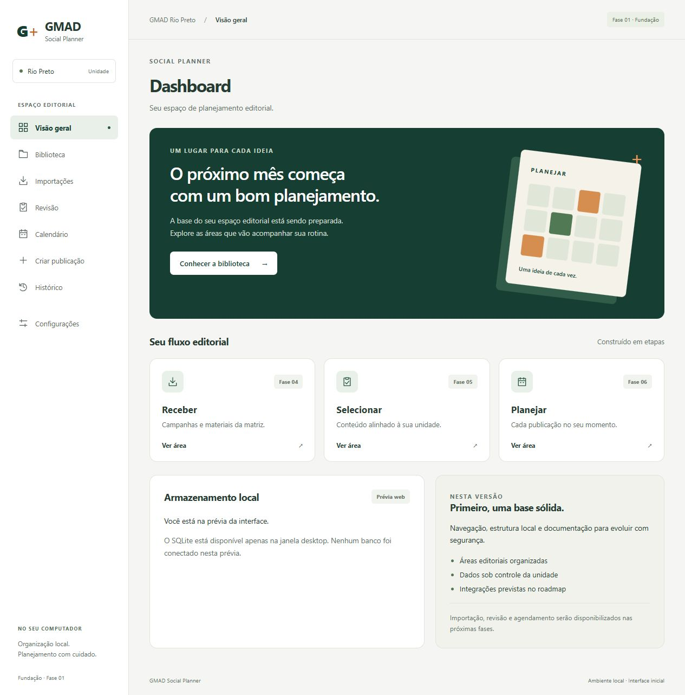

# Fase 01 — Fundação: resultado real

Data: 13/10/2026, America/Sao_Paulo.

**Estado atual: implementação e validação técnica concluídas.** A Fase 01.5 comprovou a janela nativa, navegação, IPC, SQLite e persistência após reabertura. A fundação está apta a receber aceite completo neste Windows. As fases 02–09 não foram iniciadas.

**Atualização da Fase 01.5 (13/10/2026):** Rust/Cargo 1.99.0, rustup 1.29.1, Build Tools/MSVC e SDK foram instalados com autorização. Typecheck, lint, 11 testes frontend, 2 testes SQL, 6 testes Rust, rustfmt/Clippy, cargo check e builds frontend/desktop passaram. A janela Tauri abriu, respondeu pelo IPC e preservou o banco após reabertura. Houve somente formatação Rust, lockfile/permissão gerados e ajuste do watcher Vite. Evidências e limites em [FASE_01_5_VALIDACAO_WINDOWS.md](FASE_01_5_VALIDACAO_WINDOWS.md).

## Implementado

- Documento mestre criado antes do código, com arquitetura, nove entidades planejadas, estados separados, integrações condicionais, qualidade e roadmap completo.
- Documentos complementares, README de operação Windows e AGENTS.md persistente.
- Tauri 2 + React + TypeScript estrito + Vite; dependências consultadas antes da instalação e lockfile npm gerado.
- Dashboard, menu lateral, cabeçalho, oito destinos navegáveis, estados vazios, configurações em leitura e identidade provisória verde/branco/cinza/laranja.
- Sem métricas fictícias, conteúdo editorial inventado, integração externa ou funções antecipadas. A prévia web identifica que o banco está indisponível.
- Comando Rust `foundation_status`, DTO tipado e permissão exclusiva da janela principal.
- Repositório SQLite, caminho no perfil do aplicativo, migração transacional, detecção de divergência do histórico, `quick_check`, timeout, foreign keys e preservação diante de falhas.
- Esquema mínimo: `schema_migrations` e `app_settings`, com preferência de fuso real.
- Script desktop com porta dinâmica em loopback, scripts de validação, testes automatizados e ícones locais provisórios.
- Git inicializado, identidade existente detectada; nenhum remoto configurado, push ou tag de release.

## Verificações da entrega original (histórico; bloqueios resolvidos na Fase 01.5)

| Verificação | Resultado / evidência |
| --- | --- |
| Consulta de versões/peers/engines | Executada via npm e documentação oficial; escolhas registradas em DECISOES_TECNICAS.md |
| `npm.cmd install` | Aprovado: 242 pacotes adicionados, 243 auditados, 0 vulnerabilidades reportadas nessa execução |
| `npm.cmd run typecheck` | Aprovado, TypeScript estrito |
| `npm.cmd run lint` | Aprovado, zero erros/warnings |
| `npm.cmd test` | Aprovado: 11 testes em 2 arquivos |
| `npm.cmd run test:sql` | Aprovado: 2 testes com SQLite 3.50.4 do Node; inicialização SQL, reabertura/persistência, integridade, constraints e rollback |
| `npm.cmd run build` | Aprovado: 30 módulos; saída HTML/CSS/JS em dist, ignorada no Git |
| `npm.cmd run check` | Cadeia completa frontend/SQL aprovada |
| Prévia React no navegador | Aberta via Vite local; Dashboard, Biblioteca e Configurações conferidos; navegação real e botão futuro desabilitado observados |
| Responsividade | Inspeção visual em largura padrão 1280 e overrides 640 e 390 px; sem overflow horizontal da página; navegação horizontal interna em largura reduzida |
| Console da prévia | Consulta de erros/warnings retornou lista vazia durante a inspeção |
| CLI de ícones Tauri | PNG e ICO gerados do SVG local; somente arquivos Windows necessários mantidos |
| `npm.cmd run tauri -- info` | Detectou WebView2 155.0.4283.45; Rust/Cargo/rustup e Visual Studio MSVC/SDK ausentes; configuração do projeto reconhecida |
| `npm.cmd run test:rust` | Bloqueado: comando Cargo não encontrado. Os 6 testes Rust existem, mas **não foram executados** |
| `npm.cmd run check:rust` | Bloqueado: Cargo não encontrado; rustfmt/Clippy **não validados** |
| `npm.cmd run build:desktop` | Bloqueado em `cargo metadata`: program not found; binário desktop **não produzido** |
| `npm.cmd run dev` | Detectou Cargo ausente e retornou instrução útil; janela Tauri **não abriu** |
| IPC e SQLite no processo Tauri | **Não validados em execução nativa**; mocks frontend e testes SQL não substituem essa evidência |

O Node 24.11.1 emite aviso de API experimental para `node:sqlite`; esse módulo é usado somente em testes auxiliares. A persistência de produção usa rusqlite no Rust.

A primeira tentativa de acesso ao registro npm dentro do sandbox falhou por resolução de rede; instalação/consulta foram concluídas com execução autorizada fora dele. A primeira prévia web dentro do sandbox não era acessível pelo navegador; a inspeção foi realizada com servidor em loopback fora do sandbox. Isso não adicionou backend remoto ao produto.

## Aceitação por critério

| Critério solicitado | Situação |
| --- | --- |
| 1. Mestre criado e consistente | Atendido |
| 2. Roadmap documentado | Atendido |
| 3. Arquitetura definida | Atendido |
| 4. Aplicativo inicia corretamente | Atendido: janela Windows nativa aberta e reabertura iniciada com sucesso |
| 5. Navegação básica funciona | Atendido: oito áreas conferidas na janela nativa, além dos testes frontend |
| 6. SQLite inicializa | Atendido: Rust/Tauri, integridade ok e dados preservados após reabertura |
| 7. Estrutura escalável | Atendido, fronteiras separadas e sem entidades antecipadas |
| 8. README explica execução | Atendido, incluindo instalação exata dos pré-requisitos ausentes |
| 9. Validações possíveis realizadas | Atendido, com bloqueios registrados |
| 10. Resultado real documentado | Atendido por este relatório |

## Pendências da entrega original — resolvidas na Fase 01.5

1. Instalar C++ Build Tools com MSVC x64/x86 e Windows SDK, e Rust estável MSVC, conforme README. WebView2 já existe neste computador.
2. Executar testes Rust, rustfmt/Clippy e build desktop; corrigir qualquer incompatibilidade encontrada na compilação real.
3. Gerar/versionar `src-tauri/Cargo.lock` ao resolver crates. Não foi possível gerar lockfile Rust sem Cargo.
4. Abrir com `npm.cmd run dev`; confirmar caminho real, `integrity: ok`, schema 1 e preferência carregada do banco pelo IPC.
5. Fechar/reabrir a janela e conferir banco preservado; testar navegação/teclado na WebView2 e ausência de erros críticos.

As cinco pendências acima foram resolvidas com autorização do usuário. O executável release foi compilado; a validação visual foi realizada na janela nativa de desenvolvimento. A segunda inicialização e a preservação do banco foram comprovadas pelo terminal e por leitura do arquivo. Computer Use foi interrompido pelo usuário com Escape depois disso; não houve mais interação com a janela. Os detalhes estão no relatório da Fase 01.5.

## Git e continuidade

O commit de entrega usa a mensagem `feat: initialize GMAD Social Planner foundation` e a identidade Git já configurada. Consulte `git log -1 --oneline` para o identificador final; o hash não é gravado neste mesmo commit para evitar referência circular. Não fazer push nem tag v1.0.0.

A estrutura e os documentos preparam a Fase 02, liberada tecnicamente após a validação nativa. Seu início não foi executado e depende de solicitação do usuário. A identidade presente é provisória.
