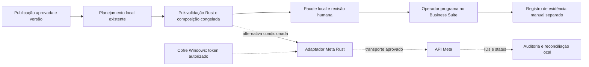

# Integração Meta — contrato futuro e segurança

**Especificação documental da Fase 07, 19/10/2026. Nenhuma integração implementada.** Referência de API: v26.0. Fontes S01–S18 e evidências estão em [Viabilidade Meta](FASE_07_VIABILIDADE_META.md). O caminho recomendado é assistido pelo Business Suite; a arquitetura de API abaixo é alternativa condicionada a novas decisões, sem endpoints ativos no aplicativo.

## Conectar a conta GMAD: caminhos oficiais

| Aspecto | Instagram Login | Facebook Login for Business |
| --- | --- | --- |
| Conta | Instagram profissional Business/Creator | Profissional Business/Creator vinculada a Página |
| Host da API | graph.instagram.com | graph.facebook.com |
| Acesso mínimo de conteúdo | instagram_business_basic e instagram_business_content_publish | instagram_basic e instagram_content_publish; pages_read_engagement conforme referências; pages_show_list para descoberta de Páginas |
| Descoberta | Identidade /me no fluxo Instagram | /me/accounts → Página → instagram_business_account |
| Escopos extras | Somente quando funcionalidade exigir | ads_management/ads_read apenas se cenário de atribuição por Business Manager exigir; sem pedir anúncios por padrão |
| Mídia | URL pública no caminho padrão | URL pública; upload retomável documentado de vídeo via rupload.facebook.com |

Não combinar hosts, app IDs e famílias de token dos dois fluxos. Selecionar uma configuração para a futura integração, revalidando o token aceito por cada endpoint. Fontes: S02, S03, S08, S09, S11. Não solicitar mensagens, comentários, insights ou publicidade só para publicar conteúdo.

Para configurar um app, o guia consultado indica caso de uso Outro, tipo Empresa/Business e produto Instagram; adaptar aos rótulos atuais do painel. Usuário proprietário/gestor e conta incluída no app podem operar em Standard Access sem App Review conforme a tabela específica de revisão; acesso a outras empresas exige Advanced Access, revisão e verificações aplicáveis. Publicar o app e habilitar acesso avançado não são sinônimos de testar a própria conta. Política de privacidade, exclusão/desautorização e verificação empresarial devem ser conferidas no cenário escolhido. Nenhum app foi criado. [S12/S13]

### OAuth e limites desktop

No Instagram Login: autorização no domínio oficial, retorno de código ao redirect_uri cadastrado, troca por token curto e eventual troca por longo. Redirect deve coincidir exatamente com o cadastrado. Não foi comprovado suporte apropriado a loopback HTTP/porta dinâmica, esquema customizado Tauri ou PKCE nessa configuração; não assumir que PKCE de outro provedor se aplica. O fluxo OAuth completo permanece bloqueado para implementação até validar callback e tratamento do segredo. [S09]

Facebook Login manual documenta alternativas desktop (login_success.html e exemplos Windows com WebAuthenticationBroker), mas isso não comprova integração OAuth moderna em Tauri 2 nem dispensa a validação de token/segredo de servidor. Não usar WebView2 para capturar senha, interceptar sessão ou automatizar login. Preferir navegador do sistema em eventual implementação validada; state aleatório, uso único, prazo curto e correlação ao pedido. Um callback não confere autenticidade por si só. [S15]

O App Secret não pode entrar no frontend, SQLite, .env versionado, logs, executável Rust ou Windows Credential Manager do cliente como substituto do servidor. A documentação exige lado servidor para as trocas com esse segredo. **Não recomendar “guardar secret só no Rust” como solução desktop.** [S09/S16]

Para uma única conta administrada pelo proprietário, S10 documenta obtenção manual de token longo no Painel de Apps, sem implementar o login no app. É uma alternativa técnica a avaliar, somente com autorização futura, sem compartilhar token no chat. Não resolve hospedagem de imagens, revisão ou agendamento remoto. Metadados de identidade e escopos devem ser validados antes de permitir qualquer envio.

### Ciclo de tokens proposto

Instagram: curto de aproximadamente uma hora; longo de até 60 dias. Renovação documentada do longo ainda válido após pelo menos 24 horas, sem reutilizar token expirado; obter validade efetiva da resposta. Facebook: tokens de usuário longos em torno de 60 dias; tokens de Página podem não ter vencimento fixo em determinadas condições, mas continuam revogáveis. Não aplicar a regra de renovação Instagram ao token Facebook. [S09/S10/S16]

Futura guarda pelo Rust no Windows Credential Manager, em namespace Meta separado do Trello; frontend recebe somente estado, conta, escopos e validade, nunca segredo recuperado. Entrada administrativa transitória deve limpar memória/controle após gravação. Sem token em URL de log, analytics, clipboard automático, SQLite, backups ou relatórios. Quando endpoint documentado exigir token em query, impedir registro de query/request completo. Limpar autenticação ao desconectar; revogação remota requer ação/autorização específica, não é comprovada por apagar cofre local.

Expiração/permissão revogada: bloquear novos envios, manter dados e mostrar reconectar. Sem tentativa de login automática. PC desligado não renova tokens; ao abrir, conferir validade antes de preparar ações. Renovação concorrente deve ser serializada e substituição no cofre deve preservar o token válido até receber resposta bem-sucedida.

## Mídia e compatibilidade

Resumo das especificações atuais, a revalidar para a família de login escolhida. [S03/S04]

| Destino | Requisitos consultados | Consequência para o GMAD |
| --- | --- | --- |
| Imagem única | JPEG sRGB, até 8 MB; proporção 4:5–1,91:1; largura 320–1440 | PNG/WebP locais precisam de derivada aprovada; não substituir original |
| Reel | MOV/MP4; H.264/HEVC, progressivo, 4:2:0; AAC até 48 kHz; 23–60 fps; 3 s–15 min; até 300 MB | Um MP4 local válido não garante codec, bitrate, duração ou layout aceitos |
| Story imagem/vídeo | JPEG ou vídeo compatível; vídeo 3–60 s, até 100 MB; 9:16 recomendado | Exigir conta elegível; recursos de stickers não são equivalentes à interface Instagram |
| Carrossel | Até 10 itens, contêineres filhos e pai | GMAD permite 20; bloquear/exportar seleção explícita, sem cortar ou dividir silenciosamente |
| Texto | Até 2.200 caracteres, 30 hashtags e 20 menções no campo caption; suporte depende do tipo | Local aceita 20.000: bloquear/solicitar revisão, nunca truncar ou remover Markdown sem prévia |

A referência contém limites adicionais de bitrate, áudio e estrutura MOV/MP4: o futuro validador deve cobri-los antes de declarar mídia pronta. Vídeo de carrossel deve ser validado pela regra própria; não aplicar indiscriminadamente o perfil Reels. Conferir também tipo real, orientação, cor, áudio e composição com ordem dos itens. Não alterar limites da biblioteca local para simular compatibilidade Meta.

Transporte padrão usa image_url/video_url acessível pela Meta. A mídia operacional permanece privada no disco; não transformar asset://, caminho Windows, localhost ou URL Trello autenticada em promessa de acesso externo. Não expor um servidor local, abrir firewall, criar túnel ou publicar URL assinada sem decisão específica. Para vídeo, S04 documenta sessão retomável que devolve URI de upload; S03 restringe esse caminho a Facebook Login for Business. Não generalizar para JPEG nem Instagram Login. URI/host de upload deve ser validado por allowlist e HTTPS; não reenviar token a redirect arbitrário. URLs temporárias de mídia também são sensíveis.

Hospedagem externa para imagens amplia o requisito atual “somente Trello e Meta”; não faz parte da recomendação inicial. O Business Suite permite ao operador selecionar o arquivo local na interface Meta, evitando infraestrutura própria de distribuição de mídia. [S14]

## Chamadas documentadas — não executadas

| Operação | Contrato público pesquisado |
| --- | --- |
| Criar contêiner | POST /{ig-user-id}/media |
| Consultar processamento | GET /{ig-container-id}?fields=status_code,status |
| Publicar imediatamente | POST /{ig-user-id}/media_publish com creation_id |
| Consultar quota | GET /{ig-user-id}/content_publishing_limit |
| Identidade Instagram Login | GET /me?fields=user_id,username no host/versionamento adequado |
| Vídeo retomável | URI oficial retornada pela sessão, host rupload.facebook.com, versão/ID conforme resposta documentada |

Não há contrato de scheduled_publish_time Instagram confirmado. Nenhuma URL acima está ligada a um comando operacional do GMAD. Rotas de tokens estão em S09/S16 e não devem ser concatenadas a partir de URLs arbitrárias do frontend. A versão deve ser fixada e atualizável explicitamente; exemplos antigos de SDK/Postman não prevalecem sobre referência vigente.

## Arquitetura proposta para a Fase 08

Manter Schedule da Fase 06 e suas três situações locais. Não reescrever migrações nem transformar cancelled_local em cancelamento Meta. Reutilizar publicationId/publicationVersion, scheduleId/version, scheduledAtUtc/timezone, hashes e ordem dos assets. Identificadores externos, tentativas e comprovação precisam de entidade separada e futura migração aditiva; não cabem em schedule_events, que audita intenção local.

Contratos conceituais, **sem criar módulos/comandos nesta fase**:

| Porta/objeto futuro | Responsabilidade e restrição |
| --- | --- |
| PreparationService / PreparedBundle | Receber IDs/versões; derivadas por hash e ordem; legenda final, formato, conta de destino, fingerprint; validação e avisos sem rede |
| AssistedPlanningRecord | Referenciar bundle/versão e registrar declaração humana, horário/fuso e evidência opcional; rótulo “registrado pelo operador”, sem confirmação API |
| MetaConnectionStatus / CredentialStore | Metadados permitidos e validade; token exclusivo do cofre Rust |
| MetaPublisher (alternativa) | Preparar/consultar/publicar com conta, versão API e confirmação explícitas; nenhuma chamada automática acionada por abrir calendário |
| PublicationAttempt / PublicationEvent (alternativa) | ID estável, fingerprint, IDs de contêiner/mídia, etapa, instante, códigos redigidos e origem da evidência; sem texto/URL/token desnecessários |
| Reconciler (alternativa) | Resolver resultado incerto por leitura, sem republicar cegamente |

Estados separados: aprovação editorial; planned_local; pacote preparado; declaração manual de programação; para API opcional, preparação/upload/processamento, pronto, publicação solicitada, publicada comprovada, falha ou resultado incerto. São nomes conceituais a definir no futuro contrato, não enums/tabelas implementados. **FINISHED = pronto**, PUBLISHED = publicado no status do contêiner; reter ID da mídia e consultar objeto/permalink quando disponível antes de exibir comprovação completa. Contêiner não publicado expira em 24h. Não preparar todos os contêineres do mês antecipadamente. [S05/S06]

Ao editar publicação ou reprogramar Schedule, invalidar a preparação local e impedir novo envio baseado em versão velha; isso não pode desfazer uma ação Meta já feita. Conteúdo já programado manualmente exige que o operador reconcilie no Business Suite. Uma divergência deve permanecer visível, sem afirmar sincronização automática.

## Falhas, idempotência e retomada propostas

Antes de qualquer tentativa: verificar versão aprovada, plano, fingerprint, conta, consentimento, mídia e conexão. Registrar intenção transacionalmente **antes** da chamada, com unicidade de ação pendente por conteúdo/destino. Não existe transação distribuída SQLite/Meta nem garantia geral de idempotency-key nos endpoints consultados.

Timeout após media_publish: marcar resultado incerto, conservar creation_id e reconciliar status/objeto antes de permitir nova publicação. Reinício após resposta remota e antes do commit local tem o mesmo tratamento. Nunca criar outro contêiner/publicação só porque faltou a resposta. Se a API não permitir provar a associação, exigir conferência humana; coincidência de legenda/horário não é prova suficiente para deduplicar.

A referência media_publish também descreve resultado com ID e config_issue (por exemplo, CAPTION_NOT_ATTACHED). Tratar como sucesso parcial que exige conferir o objeto e informar a legenda ausente; não declarar payload integralmente publicado nem criar uma segunda publicação automaticamente para corrigir. [S05]

Retentativas limitadas com backoff/jitter para leituras e falhas comprovadamente recuperáveis; respeitar quota e headers de limitação. Não repetir POST de efeito incerto automaticamente. Erro de permissão/conta/mídia exige intervenção; preservar arquivo original e aprovação. Consulta de processamento tem prazo e frequência controlados (guia recomenda uma vez/minuto por até cinco minutos); ao esgotar, guardar IDs e estado para retomada, sem declarar sucesso. [S03/S05/S06/S07]

Auditoria proposta: evento, conta/destino identificados de forma mínima, versões, hash, API version, resultado/código, fbtrace_id quando permitido e origem manual/API. Redigir request/response, queries assinadas e tokens. Rede fora do mutex editorial; transações curtas, sem lock mantido durante upload/polling. PC fechado na alternativa local não envia; ao reabrir mostrar atraso e exigir nova decisão, sem disparar todos os vencidos. Agendamento manual já registrado na Meta continua independente da execução do GMAD.
