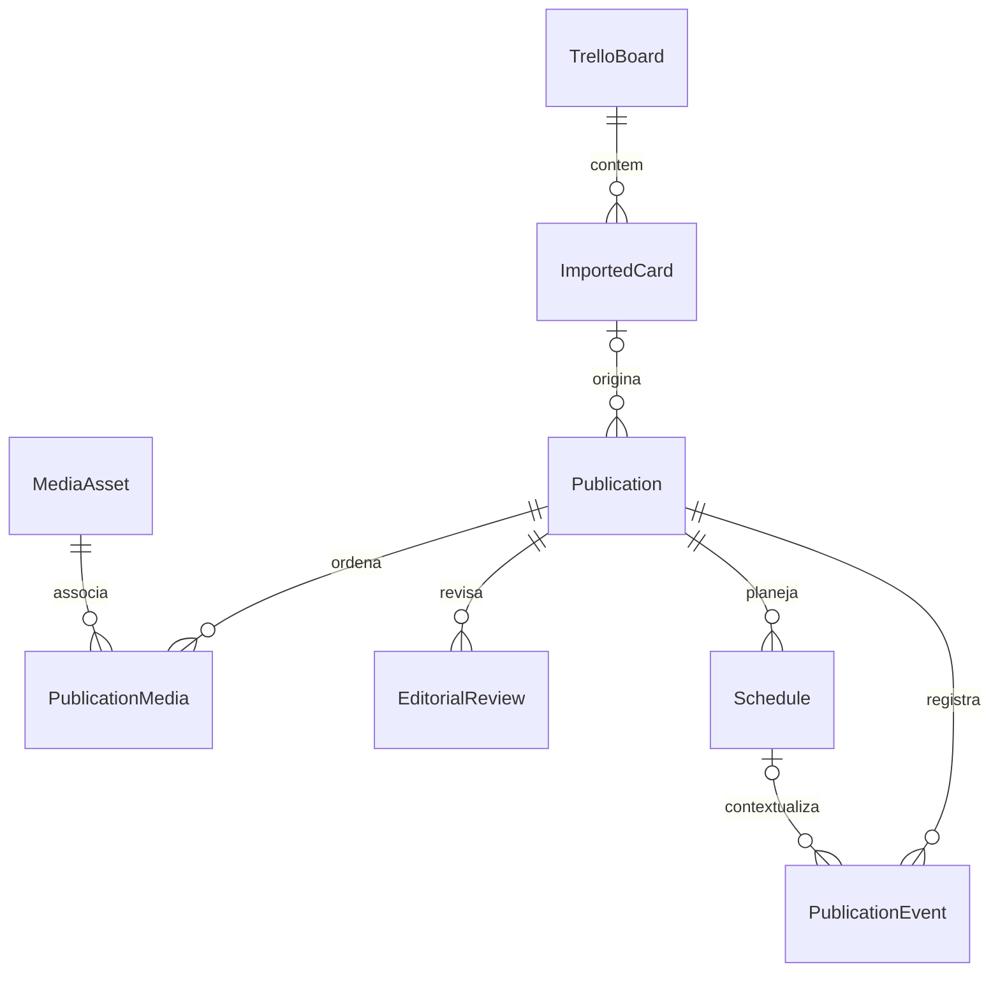

# Modelo de dados

O [Projeto mestre](PROJETO_MESTRE.md#4-modelo-de-dados-planejado) define os contratos oficiais. Fase 01: histórico/preferências. Migração incremental 002 da Fase 03: publicações, mídias e vínculos ordenados. Detalhes operacionais em [Fase 03](FASE_03_BIBLIOTECA_EDITORIAL.md).

## Esquema implementado

### schema_migrations

Criada pelo executor dentro da transação inicial. Colunas: `version INTEGER PRIMARY KEY`, `name TEXT NOT NULL`, `source_sql TEXT NOT NULL`, `applied_at TEXT NOT NULL` com data UTC. Registra a sequência e o texto SQL exato aplicado. O histórico é comparado ao manifesto compilado antes de qualquer nova migração. Alterar SQL já aplicado ou iniciar versão antiga sobre banco novo causa bloqueio conservador.

Migrações usam arquivos numerados `NNN_descricao.sql` e são registradas em `MIGRATIONS`, no Rust. Adicionar a próxima versão preservando ordem e SQL antigo. Não usar `DROP`, reset ou recriação de banco como mecanismo de atualização. Testar migração sobre banco anterior e falha transacional antes de integrar.

### app_settings

| Coluna | Tipo e restrições | Significado |
| --- | --- | --- |
| id | INTEGER PK, CHECK id = 1 | Singleton local, não representa um usuário autenticado |
| timezone | TEXT NOT NULL, não vazio | Padrão `America/Sao_Paulo` |
| created_at | TEXT NOT NULL, UTC ISO 8601 | Criação do registro |
| updated_at | TEXT NOT NULL, UTC ISO 8601 | Última atualização; futuros writes devem atualizá-la explicitamente |

A UI apenas lê essa preferência. Não há endpoint de alteração, token, credencial, publicação ou campanha pré-carregada. Contagens editoriais agora vêm de consultas às publicações reais. A validação IANA completa será necessária quando houver comando de edição da preferência; a restrição SQL atual impede valores vazios.

### publications — migração 002

UUID gerado no Rust; title obrigatório, 1–200 caracteres; caption até 20.000 caracteres, Unicode e quebras de linha preservados; search_text normalizado sem acentos para busca parcial; format (`feed`, `carousel`, `reels`, `stories`); source (`manual`, `trello`); editorial_status no eixo oficial; version positiva; created_at/updated_at UTC e deleted_at opcional.

Somente source manual e estado draft são criados/editados na Fase 03. Duplicar gera novo UUID, título de cópia e draft. Edição incrementa versão com checagem da versão anterior. Exclusão lógica mantém o registro/vínculos e retira a publicação das consultas ativas. FKs de origem Trello pertencem à migração futura da Fase 04; nenhuma tabela Trello foi criada antecipadamente.

Índices parciais por criação, última edição e formato/origem/estado, excluindo deleted_at preenchido. Consultas limitadas/paginadas não retornam todas as mídias; listagem inclui somente asset principal e quantidade.

### media_assets — migração 002

UUID, filename original, MIME, extensão canônica, size_bytes positiva, storage_path relativo único, width/height opcionais positivas, duration opcional não negativa, checksum SHA-256 único e created_at UTC. O caminho deve ser exatamente checksum + ponto + extensão, sem caminho externo.

MIMEs disponíveis: image/jpeg, image/png, image/webp e video/mp4. Metadados são obtidos da cópia validada. Arquivos por hash ficam em media/; previewPath absoluto é DTO derivado pelo Rust, fora da tabela, servido apenas pelo escopo local controlado. Mídias temporárias de formulário ficam fora do banco até salvar.

Assets compartilhados não são copiados fisicamente na duplicação. O catálogo mantém arquivos mesmo quando uma edição remove a última referência; nenhuma limpeza física automática é executada nesta fase. A exclusão lógica mantém as referências da publicação excluída. Isso preserva dados para futura recuperação/retenção explícita.

### publication_media — migração 002

publication_id FK com ON DELETE CASCADE; media_asset_id FK com ON DELETE RESTRICT; sort_order não negativo. PK do par e UNIQUE(publication_id, sort_order). Índice por asset permite consultar referências. O backend valida quantidade/tipo e ausência de hash repetido na mesma publicação antes da transação. A leitura sempre respeita sort_order.

## Evolução planejada — sem antecipar migrações futuras

Publication, MediaAsset, PublicationMedia e AppSettings já existem. A tabela abaixo registra suas extensões futuras e as entidades ainda ausentes: TrelloBoard, ImportedCard, EditorialReview, Schedule e PublicationEvent. O diagrama representa o modelo completo planejado.

| Entidade | Identidade e relações | Dados principais / proteção |
| --- | --- | --- |
| TrelloBoard | UUID local; external_board_id UNIQUE | URL canônica, nome, sincronização; nenhum token |
| ImportedCard | UUID, external_card_id UNIQUE, board_id FK | Snapshot do texto de origem, hash, timestamps, remoção lógica de origem |
| MediaAsset | UUID, chave de anexo externo única quando aplicável | MIME, bytes, hash, caminho relativo, estado do download; nunca aceitar caminho arbitrário |
| Publication | UUID, imported_card_id FK opcional | Conteúdo editável e versão; publicação manual não exige origem |
| PublicationMedia | Associação já implementada | Preservar UNIQUE do par e UNIQUE(publication_id, sort_order); ordenação não negativa |
| EditorialReview | UUID, publication_id FK | Decisão imutável, versão revisada, motivo e transição |
| Schedule | UUID, publication_id FK | Conteúdo/versionamento, horário UTC, fuso IANA, modo, estado e prova externa; só um ativo por publicação |
| PublicationEvent | UUID, publication_id FK, schedule_id opcional | Evento e evidência imutáveis, deduplicação externa, código de erro redigido |
| AppSettings | Singleton já implementado | Acrescentar preferências por migração; nunca segredos |

Uma importação cria no máximo a publicação inicial associada ao cartão. Se variantes passarem a ser necessárias, criar vínculo explícito e unicidade parcial da publicação inicial, em vez de enfraquecer a deduplicação. Um asset pode servir a várias publicações; excluir arquivo só será permitido quando não houver referência, com estratégia de recuperação.

## Estados e consistência

Não implementar um único enum que misture aprovação, intenção local e prova externa. Os três eixos e transições oficiais estão no mestre: editorial (`draft`, `pending_review`, `editing`, `approved`, `ignored`, `ready_to_schedule`); agendamento (`local`, `submitting`, `submitted`, `confirmed`, `failed`, `unknown`); publicação real (`not_published`, `published`). Na Fase 03 somente draft → draft com versão incrementada está implementado; não existe aprovação/agendamento/publicação.

Edição incrementa versão e invalida prontidão. Um Schedule referencia a versão do conteúdo, impedindo que uma edição posterior pareça ter sido enviada. Antes de reenviar um resultado incerto, reconciliar usando IDs externos/idempotência. Nenhum estado confirmado nasce de um clique de preparação local.

## Reimportação e exclusões

Identificar cartões e anexos por IDs externos; títulos não são chaves. Upsert transacional atualiza apenas snapshots da origem. Mudanças sinalizam revisão sem sobrescrever legenda/mídias organizadas pelo usuário. Downloads usam arquivo temporário, limites e conclusão atômica antes do estado disponível. Não excluir publicação porque o cartão desapareceu da origem.

Índices, foreign keys e retenção das três entidades editoriais acima estão implementados na migração 002. Entidades e contratos restantes continuam planejados para as fases próprias; não representam funcionalidades concluídas.
