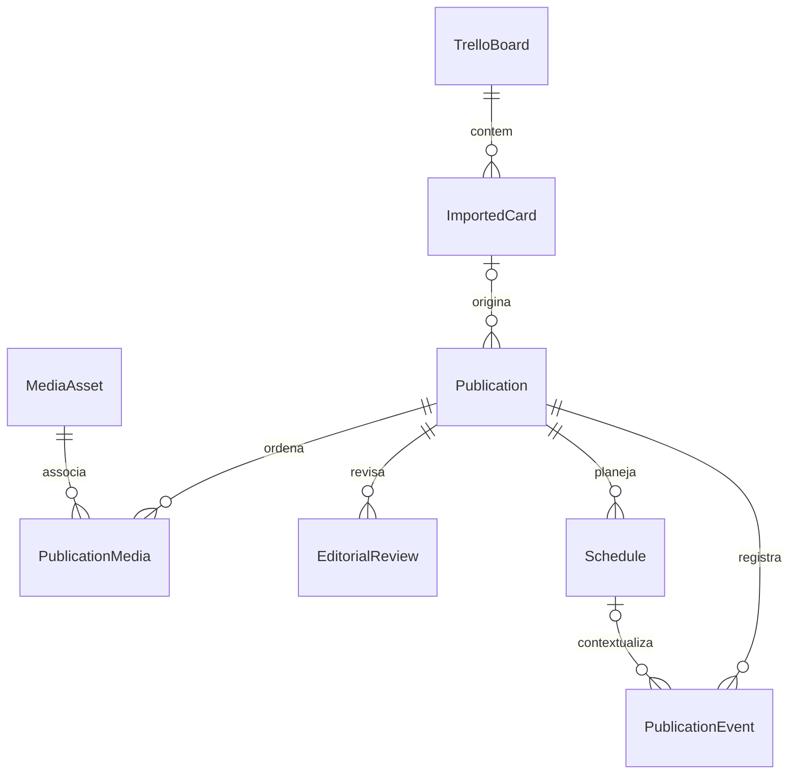

# Modelo de dados

O [Projeto mestre](PROJETO_MESTRE.md#4-modelo-de-dados-planejado) define os contratos oficiais. Fase 01: histórico/preferências. Migração incremental 002 da Fase 03: publicações, mídias e vínculos ordenados. A migração 003 da Fase 04 acrescenta origens Trello, anexos e jobs, sem alterar as migrações anteriores. A migração 004 acrescenta histórico editorial imutável por versão.

## Esquema implementado

### schema_migrations

Criada pelo executor dentro da transação inicial. Colunas: `version INTEGER PRIMARY KEY`, `name TEXT NOT NULL`, `source_sql TEXT NOT NULL`, `applied_at TEXT NOT NULL` com data UTC. Registra a sequência e o texto SQL exato aplicado. O histórico é comparado ao manifesto compilado antes de qualquer nova migração. Alterar SQL já aplicado ou iniciar versão antiga sobre banco novo causa bloqueio conservador.

Migrações usam arquivos numerados `NNN_descricao.sql` e são registradas em `MIGRATIONS`, no Rust. Adicionar a próxima versão preservando ordem e SQL antigo. Não usar `DROP`, reset ou recriação de banco como mecanismo de atualização. Testar migração sobre banco anterior e falha transacional antes de integrar.

### app_settings

| Coluna | Tipo e restrições | Significado |
| --- | --- | --- |
| id | INTEGER PK, CHECK id = 1 | Singleton local, não representa um usuário autenticado |
| timezone | TEXT NOT NULL, não vazio | Padrão `America/Sao_Paulo` |
| created_at | TEXT NOT NULL, UTC ISO 8601 | Criação do registro |
| updated_at | TEXT NOT NULL, UTC ISO 8601 | Última atualização; futuros writes devem atualizá-la explicitamente |

A UI apenas lê essa preferência. Não há endpoint de alteração, token, credencial, publicação ou campanha pré-carregada. Contagens editoriais agora vêm de consultas às publicações reais. A validação IANA completa será necessária quando houver comando de edição da preferência; a restrição SQL atual impede valores vazios.

### publications — migração 002

UUID gerado no Rust; title obrigatório, 1–200 caracteres; caption até 20.000 caracteres, Unicode e quebras de linha preservados; search_text normalizado sem acentos para busca parcial; format (`feed`, `carousel`, `reels`, `stories`); source (`manual`, `trello`); editorial_status no eixo oficial; version positiva; created_at/updated_at UTC e deleted_at opcional.

Somente source manual e estado draft são criados/editados na Fase 03. Duplicar gera novo UUID, título de cópia e draft. Edição incrementa versão com checagem da versão anterior. Exclusão lógica mantém o registro/vínculos e retira a publicação das consultas ativas. Na Fase 04, importação cria source trello e estado pending_review, editável sem transição de estado; importações subsequentes preservam a Publication. imported_cards.publication_id é FK UNIQUE para a publicação inicial. Duplicar cria manual/draft independente, inclusive para cartão textual sem mídia; a cópia manual precisará de mídia válida para salvar uma edição posterior.

Índices parciais por criação, última edição e formato/origem/estado, excluindo deleted_at preenchido. Consultas limitadas/paginadas não retornam todas as mídias; listagem inclui somente asset principal e quantidade.

### media_assets — migração 002

UUID, filename original, MIME, extensão canônica, size_bytes positiva, storage_path relativo único, width/height opcionais positivas, duration opcional não negativa, checksum SHA-256 único e created_at UTC. O caminho deve ser exatamente checksum + ponto + extensão, sem caminho externo.

MIMEs disponíveis: image/jpeg, image/png, image/webp e video/mp4. Metadados são obtidos da cópia validada. Arquivos por hash ficam em media/; previewPath absoluto é DTO derivado pelo Rust, fora da tabela, servido apenas pelo escopo local controlado. Mídias temporárias de formulário ficam fora do banco até salvar.

Assets compartilhados não são copiados fisicamente na duplicação. O catálogo mantém arquivos mesmo quando uma edição remove a última referência; nenhuma limpeza física automática é executada nesta fase. A exclusão lógica mantém as referências da publicação excluída. Isso preserva dados para futura recuperação/retenção explícita.

### publication_media — migração 002

publication_id FK com ON DELETE CASCADE; media_asset_id FK com ON DELETE RESTRICT; sort_order não negativo. PK do par e UNIQUE(publication_id, sort_order). Índice por asset permite consultar referências. O backend valida quantidade/tipo e ausência de hash repetido na mesma publicação antes da transação. A leitura sempre respeita sort_order.

## Evolução planejada — sem antecipar migrações futuras

Publication, MediaAsset, PublicationMedia, AppSettings, TrelloBoard e ImportedCard já existem. EditorialReview foi implementado na migração 004; Schedule, ScheduleEvent e preferências de planejamento na 005. PublicationEvent externo continua futuro. A tabela e o diagrama representam o modelo completo planejado; variantes de um mesmo cartão exigirão evolução explícita do vínculo inicial 1:1 implementado.

| Entidade | Identidade e relações | Dados principais / proteção |
| --- | --- | --- |
| TrelloBoard | UUID local; external_board_id UNIQUE | URL canônica, nome, sincronização; nenhum token |
| ImportedCard | UUID, external_card_id UNIQUE, board_id FK | Snapshot do texto de origem, hash, timestamps, remoção lógica de origem |
| MediaAsset | UUID, chave de anexo externo única quando aplicável | MIME, bytes, hash, caminho relativo, estado do download; nunca aceitar caminho arbitrário |
| Publication | UUID; vínculo inicial via imported_cards.publication_id UNIQUE | Conteúdo editável e versão; publicação manual não exige origem |
| PublicationMedia | Associação já implementada | Preservar UNIQUE do par e UNIQUE(publication_id, sort_order); ordenação não negativa |
| EditorialReview | UUID, publication_id FK | Decisão imutável, versão revisada, motivo e transição |
| Schedule | UUID, publication_id FK | Versão aprovada, data/hora local, UTC, fuso IANA, estado local e versão otimista; só um ativo por publicação. Prova externa não implementada |
| ScheduleEvent | INTEGER PK, schedule_id FK | Evento local imutável, instantes anteriores/novos e versões |
| PublicationEvent | UUID, publication_id FK, schedule_id opcional | Evento e evidência imutáveis, deduplicação externa, código de erro redigido |
| AppSettings | Singleton já implementado | Acrescentar preferências por migração; nunca segredos |

Uma importação cria no máximo a publicação inicial associada ao cartão. Se variantes passarem a ser necessárias, criar vínculo explícito e unicidade parcial da publicação inicial, em vez de enfraquecer a deduplicação. Um asset pode servir a várias publicações; excluir arquivo só será permitido quando não houver referência, com estratégia de recuperação.

## Estados e consistência

Não implementar um único enum que misture aprovação, intenção local e prova externa. Os três eixos e transições oficiais estão no mestre: editorial (`draft`, `pending_review`, `editing`, `approved`, `ignored`, `ready_to_schedule`); agendamento (`local`, `submitting`, `submitted`, `confirmed`, `failed`, `unknown`); publicação real (`not_published`, `published`). Fase 03 implementa draft → draft; Fase 04 acrescenta criação/edição de trello/pending_review mantendo o estado. A Fase 05 acrescenta draft → pending_review, pending_review/editing → approved/ignored e retorno explícito a pending_review. Edição de approved/ignored/editing retorna a pending_review, sem criar outro estado. Não existe agendamento/publicação externa.

Edição incrementa versão e invalida prontidão. Um Schedule referencia a versão do conteúdo, impedindo que uma edição posterior pareça ter sido enviada. Antes de reenviar um resultado incerto, reconciliar usando IDs externos/idempotência. Nenhum estado confirmado nasce de um clique de preparação local.

## Reimportação e exclusões

Identificar cartões e anexos por IDs externos; títulos não são chaves. Upsert transacional atualiza apenas snapshots da origem. Mudanças sinalizam revisão sem sobrescrever legenda/mídias organizadas pelo usuário. Downloads usam arquivo temporário, limites e conclusão atômica antes do estado disponível. Não excluir publicação porque o cartão desapareceu da origem.

Índices, foreign keys e retenção editorial estão implementados nas migrações 002–005. Revisão está implementada na Fase 05 e planejamento local na Fase 06; agendamento e evidências externas continuam planejados para as fases próprias.

## Origem Trello — migração 003

| Tabela | Contrato implementado |
| --- | --- |
| trello_boards | UUID local, remote_id UNIQUE, nome, URL canônica, created_at e last_synced_at opcional. Sem credenciais. |
| imported_cards | UUID, remote_id UNIQUE, board_id FK, publication_id FK UNIQUE, título/descrição originais completos, lista, metadata_json, hash SHA-256, data de atividade e última sincronização. Flags booleanas source_changed, source_missing e needs_adjustment. |
| trello_attachments | remote_id PK, imported_card_id FK, nome/MIME/URL sanitizada, media_asset_id FK opcional, download_status available/failed/reference/unsupported, erro redigido e removed booleano. |
| import_jobs | UUID e board_id FK, status running/completed/partial/cancelled/interrupted/failed, total/processados/sucessos/falhas, novas publicações, origens alteradas, downloads/falhas de anexo, mensagem redigida, início/fim UTC. |

Índices por quadro, cartão e início do job. IDs externos nunca são títulos nem UUIDs locais. Snapshot JSON mantém etiquetas, posição, datas, lista/arquivamento e metadados de anexos; URLs removem query/fragmento. IDs são validados antes de formar endpoints. Datas Trello não criam Schedule.

Upsert é transacional por cartão. A primeira importação cria uma única publicação pendente; as demais atualizam somente a origem. Remoção de anexo/cartão marca flags e conserva arquivos/publicações. source_changed permanece sinalizado, sem aceite automático. Erro de anexo conserva vínculo de mídia anterior, se houver. Falha do cartão não invalida cartões já concluídos.

A data do quadro avança ao concluir a seleção confirmada sem falhas; não implica que todos os cartões do quadro foram selecionados. Falhas de cartão têm contagem e mensagem final; não existe tabela de eventos por tentativa/cartão. Jobs guardam os resultados da operação, não um log de payloads. Conta/chave/token não pertencem ao modelo SQLite.

## Histórico editorial — migração 004

`editorial_reviews`: id UUID PK; publication_id FK RESTRICT; event approved/ignored/returned/submitted/edited; previous_status e next_status no enum editorial existente; reviewed_version > 0; resulting_version = reviewed_version + 1; reason opcional product/campaign/irrelevant/duplicate/other; note opcional até 2.000 caracteres; created_at UTC. Motivo/observação só são aceitos em ignored. Índices por publicação/data e eventos recentes; triggers impedem UPDATE e DELETE. Exclusão lógica da publicação conserva o histórico.

Decisão e edição usam versão esperada, incrementam a versão e gravam evento na mesma transação. Lotes são independentes por item, preservando resultados parciais. Auditoria não guarda texto editorial completo ou credenciais. A reimportação Trello preserva estado, versão e eventos editoriais. Regras e testes em [Fase 05](FASE_05_REVISAO_EDITORIAL.md).

## Planejamento local — migração 005

`schedules`: id UUID PK; publication_id FK RESTRICT; publication_version > 0; scheduled_date canônica YYYY-MM-DD; scheduled_time HH:mm; timezone IANA; scheduled_at_utc ISO UTC; status planned_local/cancelled_local/invalidated_local; version > 0; created_at/updated_at UTC; cancelled_at presente exclusivamente em cancelled_local. Índice único parcial de publication_id quando planned_local e índice por instante/estado. Proibido DELETE; registros encerrados não são reativados. Novo planejamento cria outro ID.

`schedule_settings`: singleton id=1; proximity_minutes 0–180, padrão 30; time_step_minutes 5/10/15/30/60, padrão 30; versão otimista. `schedule_events`: id INTEGER PK; schedule_id FK RESTRICT; event created_local/rescheduled_local/cancelled_local/invalidated_local; previous_date/time/timezone/utc opcionais; novos data/hora/fuso/UTC; schedule_version, publication_version e created_at UTC. Índice de eventos recentes. UPDATE/DELETE proibidos por triggers.

INSERT exige publicação ativa aprovada na versão exata; UPDATE exige estado anterior ativo, mesma publicação/versão aprovada e versão de planejamento incrementada. Ao permanecer ativo, a aprovação atual é reconferida. Auditoria é automática na transação. Trigger em alteração de versão/estado/exclusão lógica de publicação invalida todos os seus planos ativos e audita atomicamente. Arquivos e relações PublicationMedia não são alterados. Mudar snapshot Trello sem mudar conteúdo/estado/versão editorial conserva planos.

Rust valida calendário, fuso/DST, futuro, composição e integridade de arquivos; somente aprovadas são elegíveis. Datas de cartões nunca criam planos. Estados externos definidos conceitualmente acima não estão no enum persistido; nenhuma submissão ou publicação Meta é representada como executada. Regras e testes em [Fase 06](FASE_06_CALENDARIO_EDITORIAL.md).
