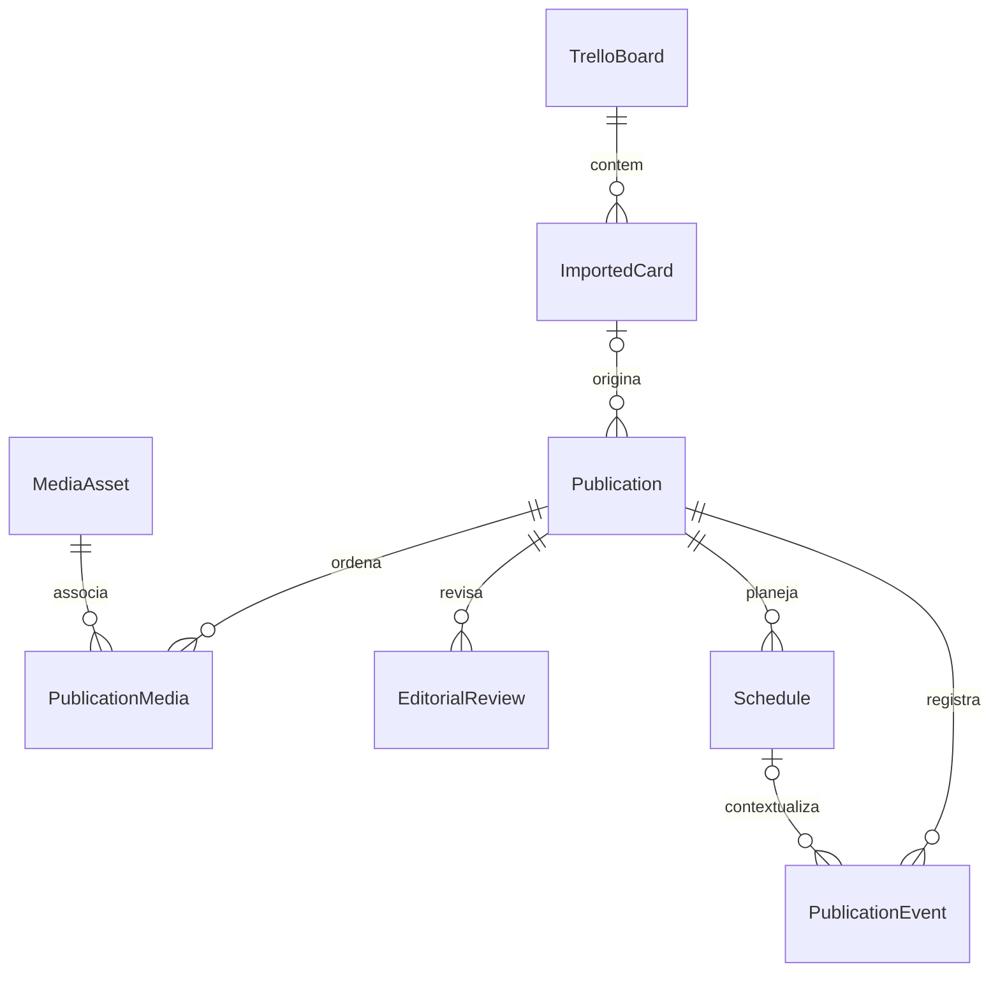

# Modelo de dados

O [Projeto mestre](PROJETO_MESTRE.md#4-modelo-de-dados-planejado) define os contratos oficiais. Só duas tabelas existem na Fase 01.

## Esquema implementado

### schema_migrations

Criada pelo executor dentro da transação inicial. Colunas: `version INTEGER PRIMARY KEY`, `name TEXT NOT NULL`, `source_sql TEXT NOT NULL`, `applied_at TEXT NOT NULL` com data UTC. Registra a sequência e o texto SQL exato aplicado. O histórico é comparado ao manifesto compilado antes de qualquer nova migração. Alterar SQL já aplicado ou iniciar versão antiga sobre banco novo causa bloqueio conservador.

Migrações usam arquivos numerados `NNN_descricao.sql` e são registradas em `MIGRATIONS`, no Rust. Adicionar a próxima versão preservando ordem e SQL antigo. Não usar `DROP`, reset ou recriação de banco como mecanismo de atualização. Testar migração sobre banco anterior e falha transacional antes de integrar.

### app_settings

| Coluna | Tipo e restrições | Significado |
| --- | --- | --- |
| id | INTEGER PK, CHECK id = 1 | Singleton local, não representa um usuário autenticado |
| timezone | TEXT NOT NULL, não vazio | Padrão `America/Sao_Paulo` |
| created_at | TEXT NOT NULL, UTC ISO 8601 | Criação do registro |
| updated_at | TEXT NOT NULL, UTC ISO 8601 | Última atualização; futuros writes devem atualizá-la explicitamente |

A UI apenas lê essa preferência. Não há endpoint de alteração, token, credencial, métrica editorial, publicação ou campanha pré-carregada. A validação IANA completa será necessária quando houver comando de edição; a restrição SQL atual impede valores vazios.

## Entidades futuras — sem tabelas nesta fase

| Entidade | Identidade e relações | Dados principais / proteção |
| --- | --- | --- |
| TrelloBoard | UUID local; external_board_id UNIQUE | URL canônica, nome, sincronização; nenhum token |
| ImportedCard | UUID, external_card_id UNIQUE, board_id FK | Snapshot do texto de origem, hash, timestamps, remoção lógica de origem |
| MediaAsset | UUID, chave de anexo externo única quando aplicável | MIME, bytes, hash, caminho relativo, estado do download; nunca aceitar caminho arbitrário |
| Publication | UUID, imported_card_id FK opcional | Conteúdo editável e versão; publicação manual não exige origem |
| PublicationMedia | publication_id e media_asset_id FKs | UNIQUE do par e UNIQUE(publication_id, position); ordenação não negativa |
| EditorialReview | UUID, publication_id FK | Decisão imutável, versão revisada, motivo e transição |
| Schedule | UUID, publication_id FK | Conteúdo/versionamento, horário UTC, fuso IANA, modo, estado e prova externa; só um ativo por publicação |
| PublicationEvent | UUID, publication_id FK, schedule_id opcional | Evento e evidência imutáveis, deduplicação externa, código de erro redigido |
| AppSettings | Singleton já implementado | Acrescentar preferências por migração; nunca segredos |

Uma importação cria no máximo a publicação inicial associada ao cartão. Se variantes passarem a ser necessárias, criar vínculo explícito e unicidade parcial da publicação inicial, em vez de enfraquecer a deduplicação. Um asset pode servir a várias publicações; excluir arquivo só será permitido quando não houver referência, com estratégia de recuperação.

## Estados e consistência

Não implementar um único enum que misture aprovação, intenção local e prova externa. Os três eixos e transições oficiais estão no mestre: editorial (`pending_review`, `editing`, `approved`, `ignored`, `ready_to_schedule`); agendamento (`local`, `submitting`, `submitted`, `confirmed`, `failed`, `unknown`); publicação real (`not_published`, `published`).

Edição incrementa versão e invalida prontidão. Um Schedule referencia a versão do conteúdo, impedindo que uma edição posterior pareça ter sido enviada. Antes de reenviar um resultado incerto, reconciliar usando IDs externos/idempotência. Nenhum estado confirmado nasce de um clique de preparação local.

## Reimportação e exclusões

Identificar cartões e anexos por IDs externos; títulos não são chaves. Upsert transacional atualiza apenas snapshots da origem. Mudanças sinalizam revisão sem sobrescrever legenda/mídias organizadas pelo usuário. Downloads usam arquivo temporário, limites e conclusão atômica antes do estado disponível. Não excluir publicação porque o cartão desapareceu da origem.

Índices, foreign keys, unicidade parcial e política de retenção serão implementados junto das respectivas entidades; este planejamento não representa funcionalidades concluídas.
